# PIJAR BEASISWA — Dokumentasi Komprehensif

> **Panduan lengkap untuk pemula:** cara memakai aplikasi, cara kerja di balik layar, daftar API, dan potongan kode penting.
>
> **Aplikasi:** PIJAR BEASISWA (Platform Beasiswa Cerdas)
> **Alamat frontend:** <http://localhost:5173>
> **Alamat backend:** <http://127.0.0.1:8000/api/v1>
> **Akun demo:** `admin@admin.com` / `password`
> **Tanggal pengujian:** 11 November 2026
> **Status:** seluruh halaman dan fitur utama sudah diuji langsung di browser.

---

## Daftar Isi

1. [Overview Sistem](#1-overview-sistem)
2. [Alur Penggunaan](#2-alur-penggunaan)
3. [Tools & Teknologi](#3-tools--teknologi)
4. [Struktur Route & Page](#4-struktur-route--page)
5. [Dokumentasi API](#5-dokumentasi-api)
6. [Detail Fitur + Screenshot](#6-detail-fitur--screenshot)
7. [Potongan Kode Penting](#7-potongan-kode-penting)
8. [Struktur Database](#8-struktur-database)
9. [Cara Menjalankan Proyek](#9-cara-menjalankan-proyek)
10. [Troubleshooting](#10-troubleshooting)
11. [Ringkasan & Batasan](#11-ringkasan--batasan)
12. [Lampiran: Indeks Screenshot](#12-lampiran-indeks-screenshot)

---

## 1. Overview Sistem

### 1.1 Apa itu PIJAR BEASISWA?

Bayangkan sebuah **loket beasiswa digital**. Mahasiswa tidak perlu lagi datang ke gedung, mengambil formulir kertas, memfotokopi transkrip, lalu menanyakan statusnya lewat pesan singkat. Semua dilakukan di satu tempat:

- melihat daftar beasiswa yang tersedia,
- membaca syaratnya,
- mengisi formulir,
- mengunggah berkas,
- dan memantau status pengajuan.

Nama **PIJAR** adalah singkatan dari **Platform Beasiswa Cerdas**. Kata "cerdas" di sini bukan sekadar nama: sistem otomatis menyaring pendaftar berdasarkan **IPK minimal 3.00**. Kalau IPK di bawah 3.00, tombol pendaftaran dikunci. Kalau memenuhi, mahasiswa bisa memilih beasiswa dan mengirim berkas.

Aplikasi ini terdiri dari dua bagian besar:

| Bagian | Istilah teknis | Tugasnya | Analogi |
|---|---|---|---|
| Tampilan | **Frontend** (React) | Menampilkan halaman, formulir, tombol, dan notifikasi | Meja resepsionis yang dilihat pengunjung |
| Otak aplikasi | **Backend** (Laravel) | Memeriksa data, menyimpan pengajuan, mencegah duplikat | Petugas di belakang loket |
| Gudang data | **Database** (SQLite) | Menyimpan daftar beasiswa dan pengajuan | Lemari arsip |

### 1.2 Masalah yang Diselesaikan

Sebelum aplikasi ini ada, proses beasiswa kampus biasanya punya beberapa masalah:

1. **Informasi tersebar.** Pengumuman ada di grup WhatsApp, website fakultas, dan papan bulletin. Mahasiswa bisa melewatkan beasiswa yang cocok.
2. **Syarat dicek manual.** Panitia harus membaca satu per satu apakah IPK pendaftar memenuhi syarat.
3. **Berkas berantakan.** Transkrip dan sertifikat dikirim lewat email dengan nama file yang berbeda-beda.
4. **Status tidak jelas.** Mahasiswa tidak tahu apakah pengajuannya sudah diterima, masih diproses, atau ditolak.
5. **Pendaftaran ganda.** Satu orang bisa mengirim beasiswa yang sama berkali-kali, membuat data panitia kotor.

PIJAR menjawab kelimanya dengan satu alur digital: katalog terpusat, filter IPK otomatis, unggah berkas PDF/ZIP, status yang bisa dipantau, dan aturan anti-duplikat.

### 1.3 Siapa Saja Penggunanya?

| Pengguna | Bisa apa saja | Perlu login? |
|---|---|---|
| **Pengunjung / mahasiswa** | Melihat beranda, katalog, detail beasiswa, dan peringkat | Tidak |
| **Mahasiswa terdaftar** | Semua di atas, ditambah mengirim pendaftaran dan melihat **Beasiswa-Ku** | Ya |
| **Panitia / admin** | Melihat data pengajuan dan mengubah status verifikasi | Ya (lewat API/database; belum ada halaman admin khusus) |

> **Catatan penting:** saat ini belum ada halaman khusus admin untuk mengubah status. Status `belum di verifikasi`, `lulus verifikasi`, dan `ditolak` tersimpan di database dan ditampilkan di halaman **Beasiswa-Ku** serta **Peringkat**. Perubahan status masih dilakukan lewat database atau alat backend.

### 1.4 Fitur Utama

| Fitur | Halaman | Ringkasan |
|---|---|---|
| Beranda | `/` | Hero, statistik, penjelasan alur, daftar beasiswa unggulan |
| Katalog beasiswa | `/beasiswa` | Pencarian, filter jenis, paginasi, tombol "Muat Lebih Banyak" |
| Detail beasiswa | `/beasiswa/:slug` | Deskripsi, syarat, warna tema, tombol daftar |
| Pendaftaran | `/daftar` | Formulir dengan gerbang IPK, pemilih beasiswa, unggah berkas |
| Beasiswa-Ku | `/beasiswa-ku` | Ringkasan jumlah pengajuan dan riwayat status |
| Peringkat | `/peringkat` | Podium tiga teratas dan tabel pendaftar berdasarkan IPK |
| Masuk | `/login` | Autentikasi dengan email dan kata sandi |
| Daftar akun | `/register` | Membuat akun baru |
| Halaman 404 | `*` | Tampilan saat alamat tidak ditemukan |

### 1.5 Arsitektur Singkat

```text
┌──────────────────────────┐
│  Browser (Chrome, dll.)  │
│  React 19 + Vite 8       │
└────────────┬─────────────┘
             │  HTTP + JSON / FormData
             │  Authorization: Bearer <token>
             ▼
┌──────────────────────────┐
│  Laravel 13 API          │
│  Sanctum + Validation    │
│  Resource + Controller   │
└────────────┬─────────────┘
             │  Eloquent ORM
             ▼
┌──────────────────────────┐
│  SQLite                  │
│  users · scholarships    │
│  beasiswas               │
└──────────────────────────┘
```

Cara membacanya:

1. Pengguna membuka halaman di browser.
2. React mengirim permintaan ke alamat `/api/v1/...`.
3. Laravel memeriksa apakah pengguna sudah login, apakah datanya valid, dan apakah sudah pernah mendaftar beasiswa yang sama.
4. Kalau lolos, Laravel menyimpan data ke SQLite dan mengirim jawaban JSON.
5. React menampilkan notifikasi dan memindahkan pengguna ke halaman **Beasiswa-Ku**.

### 1.6 Hubungan Data

```text
users (mahasiswa)
  │ 1
  │
  │ N
beasiswas (pengajuan)
  │ N
  │
  │ 1
scholarships (master beasiswa)
```

Artinya:

- Satu mahasiswa boleh punya **banyak pengajuan**.
- Setiap pengajuan menunjuk ke **satu beasiswa**.
- Pasangan `(user_id, scholarship_id)` dibuat **unik**. Jadi satu mahasiswa tidak bisa mendaftar dua kali pada beasiswa yang sama, tetapi tetap bisa mendaftar ke beasiswa lain.

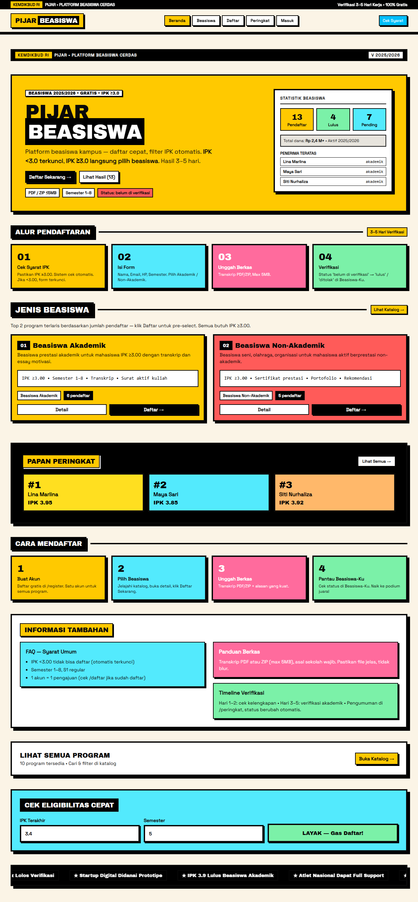

*Gambar 1 — Beranda: identitas aplikasi, navigasi, hero, dan penjelasan singkat alur.*

---

## 2. Alur Penggunaan

Bagian ini mengikuti perjalanan pengguna dari pertama kali membuka aplikasi sampai melihat status pengajuan. Setiap langkah disertai screenshot asli.

### 2.1 Ringkasan Alur

```text
Buka beranda
   ↓
Lihat katalog → pilih beasiswa → baca detail
   ↓
Daftar akun (jika belum punya)
   ↓
Masuk
   ↓
Buka formulir pendaftaran
   ↓
Cek IPK
   ├── IPK < 3.00 → form terkunci (tidak bisa lanjut)
   └── IPK ≥ 3.00 → pilih beasiswa
                        ↓
                 isi data + unggah PDF/ZIP ≤ 5MB
                        ↓
                     kirim
                        ↓
          diarahkan ke Beasiswa-Ku
                        ↓
             pantau status verifikasi
```

### 2.2 Langkah 0 — Siapkan Akun Demo

Kalau baru pertama kali mencoba, gunakan akun yang sudah disediakan:

| Field | Nilai |
|---|---|
| Email | `admin@admin.com` |
| Kata sandi | `password` |

Akun ini sudah memiliki beberapa pengajuan contoh, sehingga halaman **Beasiswa-Ku** langsung terisi dan mudah dipelajari.

### 2.3 Langkah 1 — Buka Beranda

Buka <http://localhost:5173>. Di beranda pengguna melihat:

- nama aplikasi dan menu navigasi: **Beranda**, **Beasiswa**, **Daftar**, **Peringkat**, **Beasiswa-Ku**;
- tombol **Cek Syarat**;
- hero besar dengan penjelasan singkat;
- statistik jumlah beasiswa dan pendaftar;
- kartu-kartu beasiswa unggulan;
- penjelasan alur pendaftaran.

Kalau belum login, menu **Beasiswa-Ku** tetap terlihat tetapi akan mengarahkan ke halaman masuk ketika diklik. Ini disengaja: pengguna tahu fitur itu ada, lalu diminta login.

### 2.4 Langkah 2 — Jelajahi Katalog

Buka menu **Beasiswa**. Halaman katalog menampilkan kartu beasiswa dengan nama, jenis, deskripsi singkat, dan jumlah pendaftar.

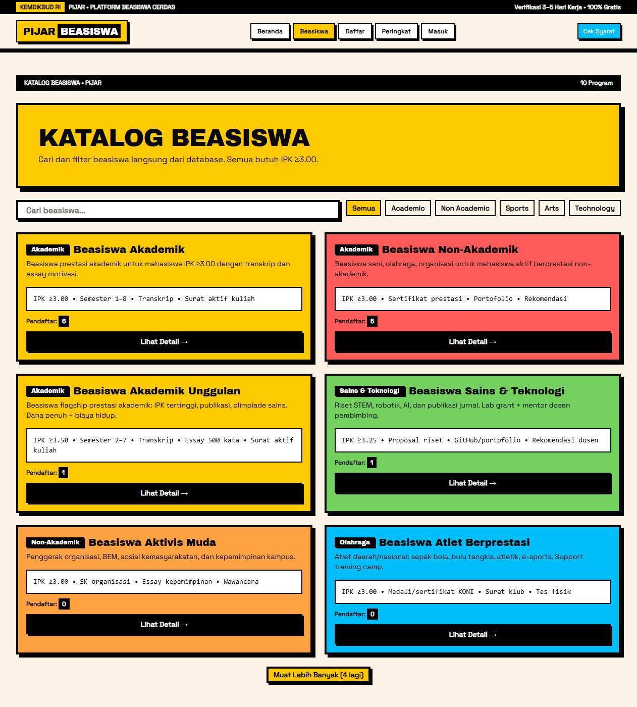

*Gambar 2 — Katalog beasiswa dengan kartu, filter, dan kolom pencarian.*

Yang bisa dilakukan di sini:

- mengetik kata kunci di kolom pencarian;
- memilih filter jenis: **Semua**, **Akademik**, **Non-Akademik**, **Olahraga**, **Seni**, **Teknologi**;
- menekan **Muat Lebih Banyak** untuk melihat beasiswa berikutnya.

### 2.5 Langkah 3 — Baca Detail Beasiswa

Klik salah satu kartu, misalnya **Beasiswa Akademik**. Alamatnya menjadi `/beasiswa/akademik`.

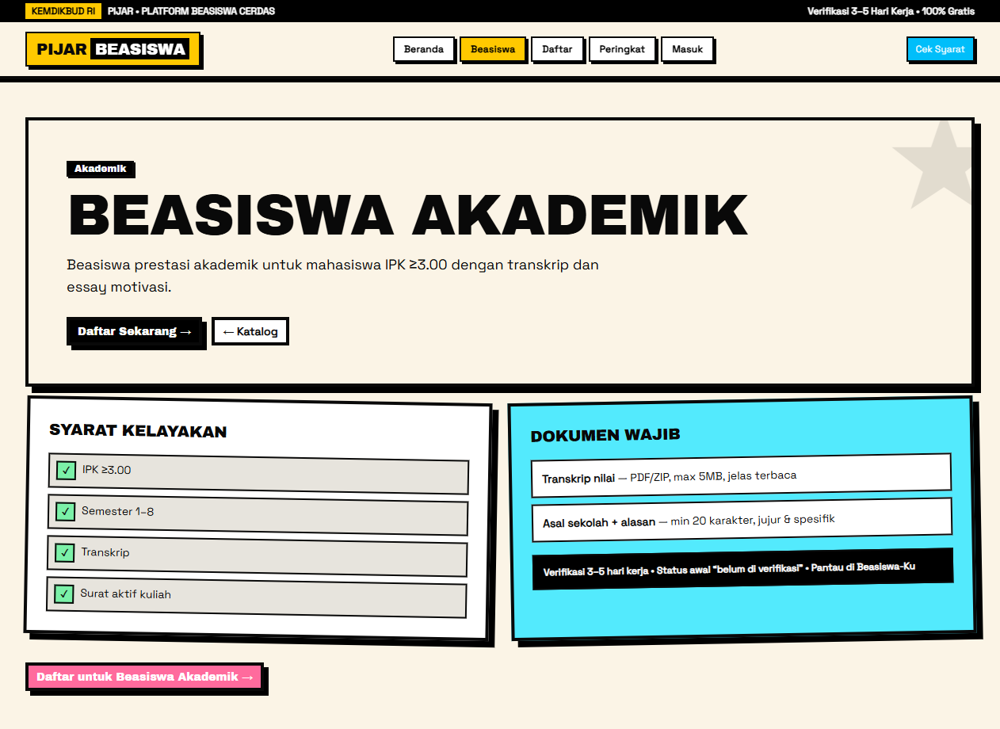

*Gambar 3 — Halaman detail: deskripsi, syarat, dan tombol pendaftaran.*

Halaman detail menjelaskan:

- apa itu beasiswa tersebut;
- syarat dalam bentuk poin-poin;
- warna tema yang membedakan satu beasiswa dengan yang lain;
- tombol menuju formulir dengan beasiswa tersebut sudah terpilih otomatis.

Tombol ini membawa `scholarship_id` lewat URL, sehingga pengguna tidak perlu memilih ulang di formulir.

### 2.6 Langkah 4 — Buat Akun (Jika Belum Punya)

Buka **Daftar** atau alamat `/register`.

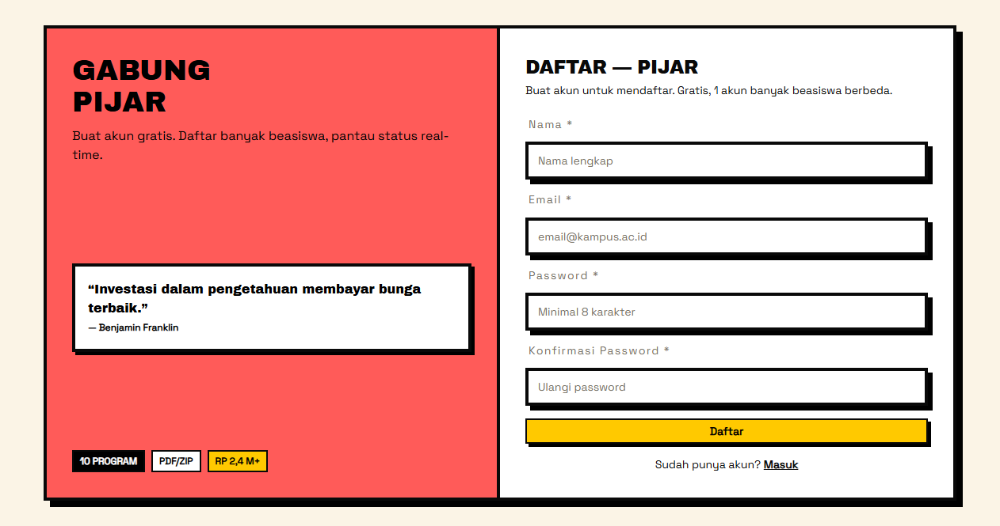

*Gambar 4 — Formulir pembuatan akun.*

Isi nama, email, kata sandi, dan konfirmasi kata sandi. Setelah berhasil, pengguna bisa masuk dengan akun tersebut.

### 2.7 Langkah 5 — Masuk

Buka `/login`, lalu isi email dan kata sandi.

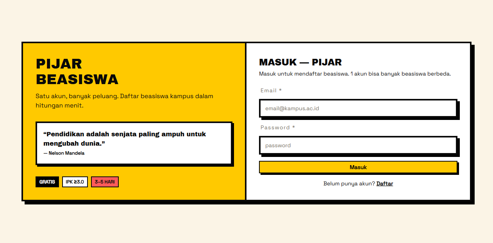

*Gambar 5 — Halaman masuk dengan email dan kata sandi.*

Setelah login:

- nama pengguna muncul di navigasi;
- tombol **Keluar** tersedia;
- menu **Beasiswa-Ku** bisa dibuka;
- formulir pendaftaran bisa diakses.

### 2.8 Langkah 6 — Buka Formulir Pendaftaran

Buka menu **Daftar** atau alamat `/daftar`. Halaman ini dilindungi: kalau belum login, pengguna otomatis diarahkan ke `/login`.

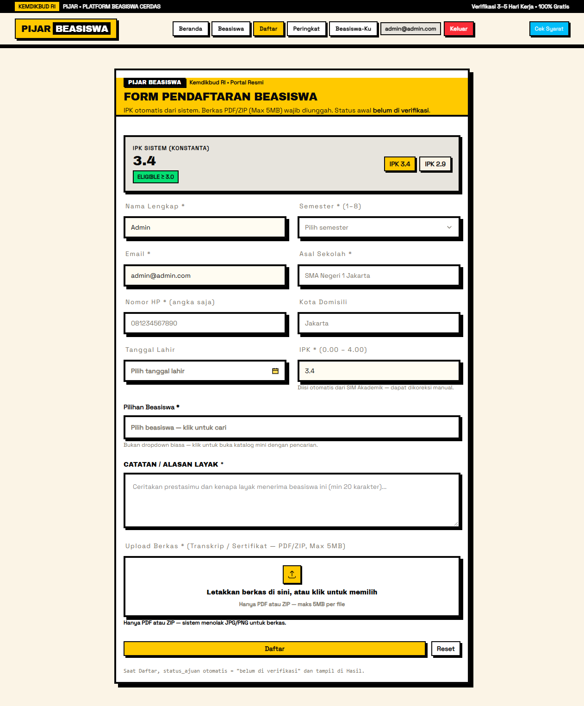

*Gambar 6 — Formulir pendaftaran dengan panel IPK, data diri, pilihan beasiswa, catatan, dan unggah berkas.*

Formulir berisi:

| Bagian | Field | Keterangan |
|---|---|---|
| Data diri | Nama lengkap | Otomatis terisi dari akun, masih bisa diubah |
| | Email | Otomatis terisi dari akun |
| | Nomor HP | Hanya angka, 10–15 digit |
| | Semester | Pilihan 1–8 |
| | Asal sekolah | Minimal 3 karakter |
| | Kota domisili | Opsional |
| | Tanggal lahir | Opsional, harus tanggal lampau |
| Akademik | IPK | Angka 0.00–4.00 |
| Pilihan | Beasiswa | Dibuka lewat dialog pencarian |
| Berkas | Catatan/alasan | Minimal 20 karakter |
| | Upload berkas | PDF atau ZIP, maksimal 5MB, satu file |

### 2.9 Langkah 7 — Gerbang IPK ≥ 3.00

Ini adalah aturan paling penting di aplikasi. Di bagian atas formulir ada panel **IPK Sistem (Konstanta)** dengan dua tombol demo:

- **IPK 3.4** → memenuhi syarat;
- **IPK 2.9** → tidak memenuhi syarat.

Kalau IPK di bawah 3.00:

- pilihan beasiswa berubah menjadi **Terkunci — IPK < 3.0**;
- area unggah berkas dinonaktifkan;
- tombol **Daftar** tidak bisa ditekan;
- muncul peringatan merah **"IPK di bawah 3.00 — Pendaftaran Terkunci"**.

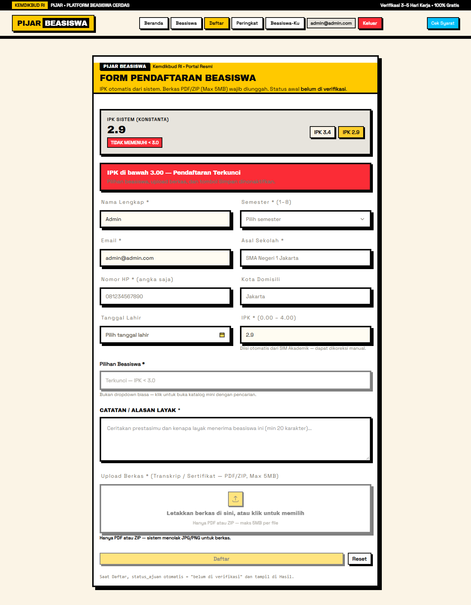

*Gambar 7 — Gerbang IPK: seluruh langkah lanjutan dikunci saat IPK 2.9.*

Kalau IPK 3.00 atau lebih:

- label berubah menjadi **ELIGIBLE ≥ 3.0**;
- pilihan beasiswa terbuka;
- unggah berkas dan tombol **Daftar** aktif.

> **Kenapa IPK-nya bisa diubah-ubah?** Untuk keperluan demo dan penilaian, IPK diambil dari konstanta aplikasi (`useBeasiswaStore`), bukan dari sistem akademik sungguhan. Di produksi, angka ini seharusnya datang dari API akademik kampus. Server tetap memvalidasi bahwa IPK berada di rentang 0–4, dan aturan kelayakan tetap diterapkan di sisi tampilan.

### 2.10 Langkah 8 — Pilih Beasiswa

Klik kolom **Pilihan Beasiswa**. Muncul dialog dengan kotak pencarian dan daftar beasiswa.

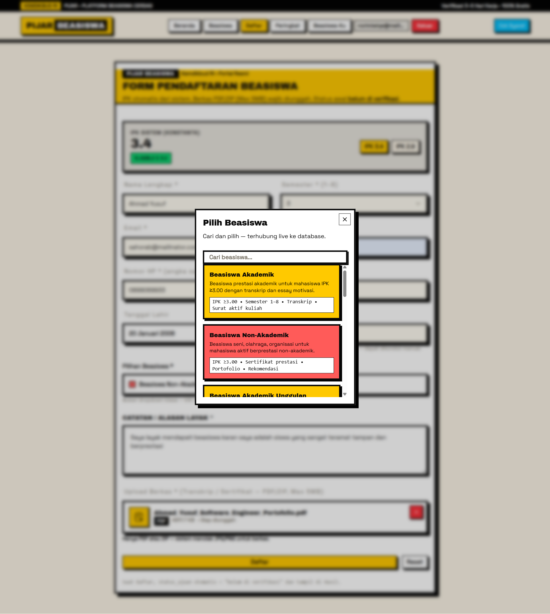

*Gambar 8 — Dialog pemilih beasiswa dengan pencarian langsung dan kartu syarat.*

Setiap kartu menampilkan:

- nama beasiswa;
- deskripsi singkat;
- syarat ringkas;
- warna tema.

Klik salah satu kartu untuk memilih. Dialog menutup dan kolom terisi.

### 2.11 Langkah 9 — Isi Data dan Unggah Berkas

Lengkapi semua field. Untuk berkas:

1. klik area **Letakkan berkas di sini, atau klik untuk memilih**;
2. pilih file PDF atau ZIP;
3. pastikan ukuran tidak lebih dari 5MB.

Sistem menolak JPG/PNG dan file di atas 5MB. Ini penting karena panitia hanya menerima dokumen resmi dalam format PDF atau arsip ZIP.

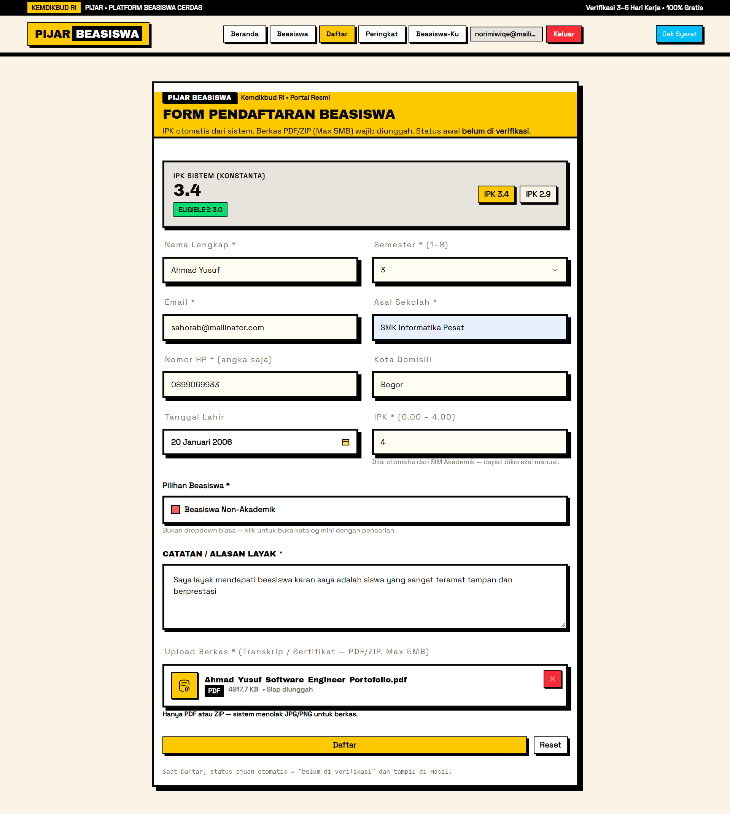

*Gambar 9 — Formulir terisi lengkap sebelum dikirim.*

### 2.12 Langkah 10 — Kirim Pendaftaran

Tekan **Daftar**. Yang terjadi:

1. browser mengirim data sebagai `FormData` (karena ada file);
2. backend memeriksa token login;
3. backend memvalidasi semua field;
4. backend mencari `scholarship_id` yang dipilih;
5. backend memeriksa apakah pengguna sudah pernah mendaftar beasiswa itu;
6. file disimpan ke folder `storage/app/public/berkas`;
7. data disimpan dengan status awal **`belum di verifikasi`**;
8. frontend menampilkan notifikasi **"Pendaftaran berhasil"**;
9. pengguna diarahkan ke `/beasiswa-ku`.

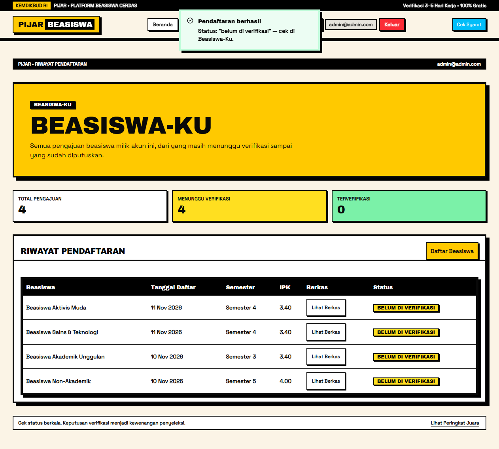

*Gambar 10 — Setelah kirim: jumlah pengajuan bertambah dan baris baru muncul di riwayat.*

### 2.13 Langkah 11 — Pantau di Beasiswa-Ku

Halaman **Beasiswa-Ku** adalah tempat mahasiswa melihat semua pengajuannya.

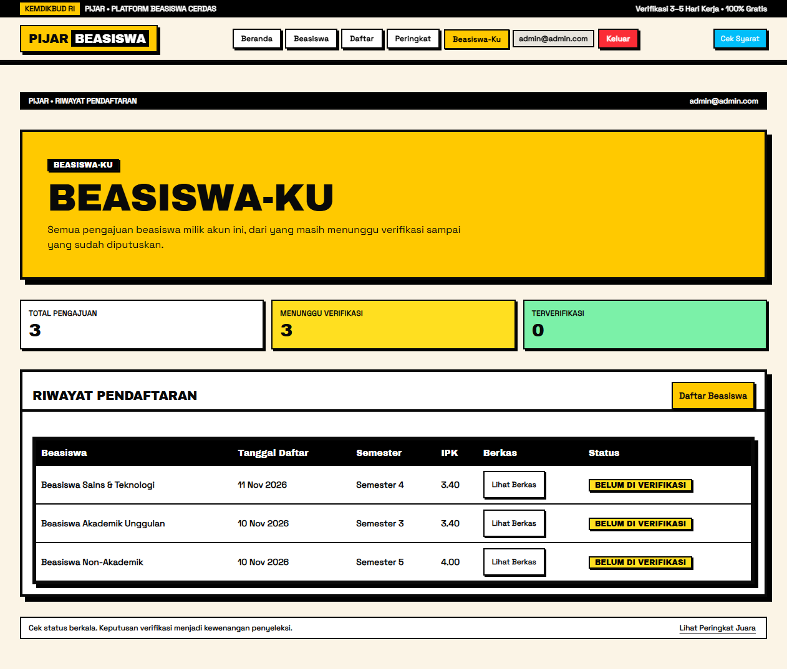

*Gambar 11 — Beasiswa-Ku sebelum pengajuan demo: tiga pengajuan dengan status belum diverifikasi.*

Isi halaman:

| Bagian | Arti |
|---|---|
| **Total Pengajuan** | Jumlah semua pengajuan milik pengguna |
| **Menunggu Verifikasi** | Pengajuan dengan status `belum di verifikasi` |
| **Terverifikasi** | Pengajuan dengan status `lulus verifikasi` |
| **Riwayat Pendaftaran** | Tabel: nama beasiswa, tanggal, semester, IPK, berkas, status |

Tombol **Lihat Berkas** membuka file yang diunggah. Kalau file tidak bisa dibuka, lihat bagian [Troubleshooting](#10-troubleshooting).

### 2.14 Langkah 12 — Lihat Peringkat

Buka **Peringkat** untuk melihat pendaftar dengan IPK tertinggi.

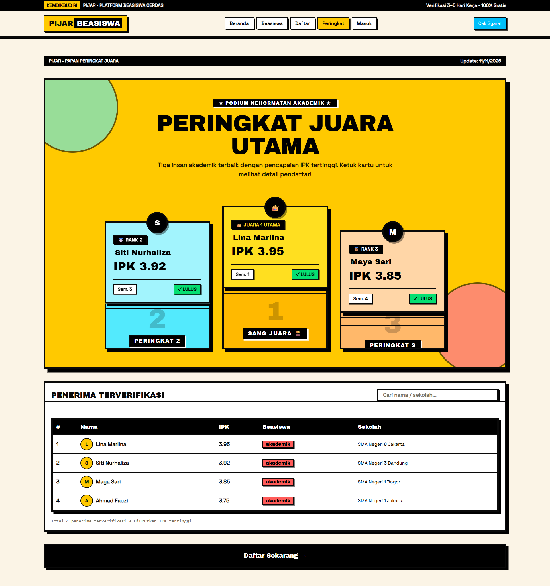

*Gambar 12 — Podium tiga teratas dan tabel peringkat.*

Halaman ini menampilkan:

- podium juara 1, 2, dan 3;
- tabel pendaftar dengan kolom nama, asal sekolah, semester, IPK, dan status;
- kolom pencarian nama;
- paginasi.

### 2.15 Alur Singkat dalam Tabel

| Langkah | Aksi pengguna | Yang terjadi di sistem | Bukti |
|---|---|---|---|
| 1 | Buka beranda | React memuat halaman dan data statistik | `01-beranda.png` |
| 2 | Buka katalog | API `/scholarships` dipanggil | `02-katalog-beasiswa.png` |
| 3 | Buka detail | Daftar beasiswa dimuat, lalu dicari berdasarkan `slug` | `03-detail-beasiswa.png` |
| 4 | Daftar akun | API `/register` membuat user baru | `06-daftar-akun.png` |
| 5 | Masuk | API `/login` mengembalikan token | `05-masuk.png` |
| 6 | Buka formulir | Protected route memeriksa token | `08-form-pendaftaran.png` |
| 7 | Cek IPK | Gate klien mengunci/membuka form | `09-form-ipk-tidak-memenuhi.png` |
| 8 | Pilih beasiswa | Dialog mencari data master | `10-dialog-pilih-beasiswa.png` |
| 9 | Isi + unggah | Validasi Zod di browser | `12-form-terisi.png` |
| 10 | Kirim | API `/beasiswa` menyimpan + status | `13-beasiswa-ku-setelah-daftar.png` |
| 11 | Pantau | API `/my-beasiswa` | `11-beasiswa-ku.png` |
| 12 | Peringkat | API `/beasiswa?sort=ipk_desc` | `04-peringkat.png` |

---

## 3. Tools & Teknologi

### 3.1 Ringkasan Teknologi

| Lapisan | Teknologi | Versi | Fungsi sederhananya |
|---|---|---|---|
| Bahasa backend | PHP | 8.3+ (8.4 di mesin uji) | Bahasa yang dipakai server |
| Framework backend | Laravel | 13.8 | Kerangka kerja: routing, validasi, database |
| Autentikasi | Laravel Sanctum | 4.x | Membuat dan memeriksa token login |
| Database lokal | SQLite | Bawaan PHP | File database tunggal, mudah dibawa |
| Dokumentasi API | Scramble | 0.13 | Menghasilkan OpenAPI dari kode Laravel |
| Testing backend | Pest | 4.7 | Menjalankan tes otomatis |
| Formatter backend | Pint | 1.27 | Merapikan gaya kode PHP |
| Bahasa frontend | TypeScript | 6.0 | JavaScript dengan tipe data |
| Framework UI | React | 19.2 | Membangun tampilan dari komponen |
| Build tool | Vite | 8.2 | Server pengembangan dan bundling |
| Routing | React Router | 8.3 | Memetakan URL ke halaman |
| Styling | Tailwind CSS | 4.3 | Menulis gaya langsung di elemen |
| Komponen UI | Neobrutalism / shadcn base | 4.x | Tombol, dialog, tabel, badge |
| Formulir | TanStack React Form | 1.33 | Mengelola nilai, error, dan submit |
| Validasi | Zod | 4.5 | Aturan validasi yang bisa dibaca manusia |
| Data fetching | TanStack React Query | 5.102 | Cache, refetch, dan status loading |
| HTTP client | ky | 2.1 | Pembungkus `fetch` dengan prefix URL |
| State global | Zustand | 5.0 | Menyimpan user, token, dan IPK demo |
| Notifikasi | Sonner | 2.0 | Toast sukses/gagal |
| Animasi | GSAP + Framer Motion | 3.15 / 13.2 | Animasi podium dan transisi |
| Ikon | Hugeicons + Lucide | — | Ikon di navigasi dan tombol |
| SEO | react-helmet-async | 3.0 | Judul, deskripsi, dan metadata halaman |

### 3.2 Kenapa Memilih Teknologi Ini?

**React + Vite.** React memecah tampilan menjadi komponen kecil yang bisa dipakai ulang. Vite membuat perubahan kode langsung terlihat di browser dalam hitungan milidetik.

**TypeScript.** Kalau kita salah menulis nama field, editor langsung memberi tanda merah sebelum aplikasi dijalankan. Ini mengurangi bug sepele.

**Laravel.** Laravel sudah menyediakan routing, validasi, ORM, resource, dan autentikasi. Kita tidak perlu menulis semuanya dari nol.

**SQLite.** Untuk pengembangan lokal, database cukup berupa satu file. Tidak perlu memasang server database terpisah. Untuk produksi, proyek ini sudah menyiapkan jalur ke PostgreSQL/Neon.

**TanStack Query.** Data dari server disimpan sementara di browser. Setelah pendaftaran berhasil, cache `beasiswa` dan `my-beasiswa` dibersihkan otomatis sehingga halaman langsung menampilkan data terbaru.

**Zod + Form Request.** Validasi dilakukan dua kali: di browser agar pengguna cepat mendapat pesan, dan di server agar data tetap aman meskipun seseorang memanggil API langsung.

### 3.3 Struktur Folder

```text
scholarship-portal-system/
├── assets/
│   └── images/
│       └── mockup/              # 19 screenshot dokumentasi ini
├── backend/
│   ├── app/
│   │   ├── Enums/
│   │   │   └── ScholarshipType.php
│   │   ├── Http/
│   │   │   ├── Controllers/
│   │   │   │   ├── BeasiswaController.php
│   │   │   │   └── ScholarshipController.php
│   │   │   ├── Requests/
│   │   │   │   └── BeasiswaRequest.php
│   │   │   └── Resources/
│   │   │       ├── BeasiswaResource.php
│   │   │       └── ScholarshipResource.php
│   │   └── Models/
│   │       ├── Beasiswa.php
│   │       ├── Scholarship.php
│   │       └── User.php
│   ├── database/
│   │   ├── migrations/          # skema tabel
│   │   └── seeders/             # data contoh
│   └── routes/
│       └── api.php              # semua endpoint /api/v1
├── docs/
│   └── pijar-beasiswa-komprehensif.md   # dokumen ini
└── frontend/
    ├── src/
    │   ├── api/ky.ts            # konfigurasi HTTP + token
    │   ├── components/
    │   │   ├── auth/ProtectedRoute.tsx
    │   │   └── ui/core/block/   # blok halaman (daftar, beasiswa-ku, dll.)
    │   ├── features/beasiswa/   # API + hooks React Query
    │   ├── hooks/use-form.ts    # pabrik form TanStack
    │   ├── pages/               # halaman per route
    │   ├── router/index.tsx     # peta URL → halaman
    │   └── store/               # Zustand (auth + IPK)
    └── package.json
```

---

## 4. Struktur Route & Page

### 4.1 Tabel Route

| URL | Halaman | Dilindungi? | Fungsi |
|---|---|---|---|
| `/` | `HomePage` | Tidak | Beranda dan ringkasan fitur |
| `/beasiswa` | `BeasiswaCatalogPages` | Tidak | Katalog + pencarian + filter |
| `/beasiswa/:slug` | `BeasiswaDetailPage` | Tidak | Detail satu beasiswa |
| `/login` | `LoginPage` | Tidak | Masuk |
| `/register` | `MasterRegisterBlock` | Tidak | Daftar akun |
| `/daftar` | `DaftarPage` | **Ya** | Formulir pendaftaran beasiswa |
| `/beasiswa-ku` | `BeasiswaKuPage` | **Ya** | Riwayat pengajuan pengguna |
| `/peringkat` | `PeringkatPage` | Tidak | Peringkat IPK |
| `*` | `NotFound` | Tidak | Halaman 404 |

### 4.2 Apa Artinya "Dilindungi"?

Halaman `/daftar` dan `/beasiswa-ku` hanya boleh dibuka oleh pengguna yang sudah login. Pemeriksaannya dilakukan oleh komponen `ProtectedRoute`:

```tsx
export function ProtectedRoute({ children }: { children: React.ReactNode }) {
  const user = useAuthStore((s) => s.user)
  const token = useAuthStore((s) => s.token)
  if (!user || !token) return <Navigate to="/login" replace />
  return <>{children}</>
}
```

Cara kerjanya:

1. Ambil `user` dan `token` dari penyimpanan global.
2. Kalau salah satunya kosong, pindahkan pengguna ke `/login`.
3. Kalau keduanya ada, tampilkan halaman yang diminta.

Karena `replace` dipakai, halaman login menggantikan halaman yang dilindungi di riwayat browser. Pengguna tidak bisa menekan tombol "Back" untuk kembali ke halaman yang belum boleh diakses.

### 4.3 Peta Halaman ke Komponen

```text
/daftar
└── DaftarPage
    └── MasterDaftarBlock
        ├── panel IPK
        ├── form data diri
        ├── ScholarshipPickerDialog
        ├── MediaDropzone (berkas)
        └── tombol Daftar / Reset

/beasiswa-ku
└── BeasiswaKuPage
    └── BeasiswaKu
        ├── kartu Total Pengajuan
        ├── kartu Menunggu Verifikasi
        ├── kartu Terverifikasi
        └── tabel Riwayat Pendaftaran
```

### 4.4 Halaman 404

Kalau pengguna mengetik alamat yang tidak ada, React Router menampilkan halaman 404.

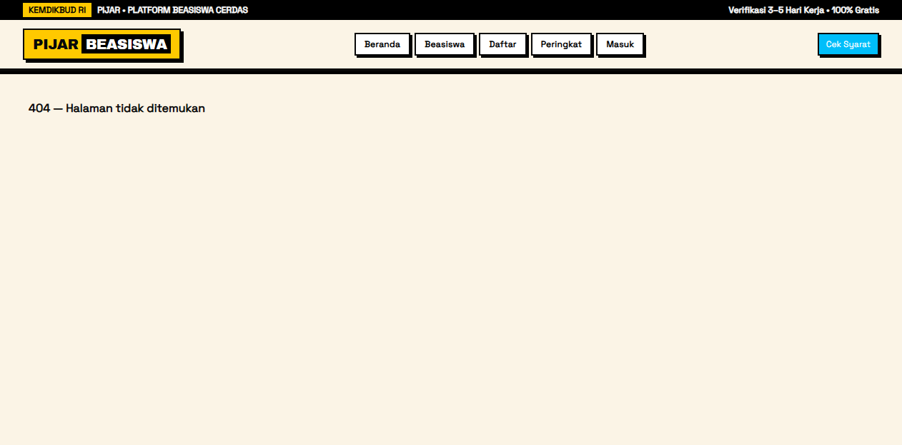

*Gambar 13 — Halaman 404 untuk alamat yang tidak dikenal.*

Halaman ini sengaja sederhana dan tetap memakai navigasi utama, sehingga pengguna bisa kembali ke beranda atau katalog.

### 4.5 Tampilan Mobile

Tampilan diuji pada lebar 390 piksel (ukuran ponsel).

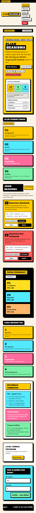

*Gambar 14 — Beranda pada layar ponsel: navigasi dan kartu menyesuaikan lebar.*

Prinsip responsifnya:

- grid kartu berubah dari beberapa kolom menjadi satu kolom;
- navigasi membungkus ke baris berikutnya;
- tombol tetap cukup besar untuk disentuh;
- tabel riwayat bisa digulir horizontal pada layar sempit.

---

## 5. Dokumentasi API

### 5.1 Informasi Dasar

| Item | Nilai |
|---|---|
| Base URL | `http://127.0.0.1:8000/api/v1` |
| Format data | JSON, kecuali unggah berkas memakai `multipart/form-data` |
| Autentikasi | `Authorization: Bearer <token>` dari Sanctum |
| Header wajib | `Accept: application/json` |
| Prefix versi | `/v1` |

### 5.2 Daftar Endpoint

| Method | Path | Auth | Fungsi |
|---|---|---|---|
| `GET` | `/scholarships` | — | Daftar beasiswa master |
| `GET` | `/scholarships/{scholarship}` | — | Detail satu beasiswa master |
| `GET` | `/beasiswa` | — | Daftar pengajuan (untuk peringkat) |
| `GET` | `/beasiswa/{beasiswa}` | — | Detail satu pengajuan |
| `POST` | `/beasiswa` | Bearer | Kirim pengajuan baru |
| `GET` | `/my-beasiswa` | Bearer | Pengajuan milik pengguna login |
| `POST` | `/register` | — | Buat akun |
| `POST` | `/login` | — | Masuk dan dapatkan token |
| `POST` | `/logout` | Bearer | Keluar |
| `GET` | `/user` | Bearer | Data pengguna saat ini |

### 5.3 Format Jawaban

Semua daftar memakai amplop yang sama:

```json
{
  "data": [],
  "meta": {
    "current_page": 1,
    "per_page": 10,
    "total": 10,
    "last_page": 1
  }
}
```

- `data` berisi array item.
- `meta` berisi informasi paginasi.
- Detail tunggal memakai `{ "data": { ... } }`.
- Pesan sukses/error memakai `{ "message": "..." }`.

### 5.4 Contoh: Daftar Beasiswa Master

**Request**

```bash
curl "http://127.0.0.1:8000/api/v1/scholarships?per_page=3"
```

**Response (dipotong)**

```json
{
  "data": [
    {
      "id": 9,
      "name": "Beasiswa Akademik",
      "slug": "akademik",
      "type": "academic",
      "type_label": "Akademik",
      "description": "Beasiswa prestasi akademik untuk mahasiswa IPK ≥3.00 dengan transkrip dan essay motivasi.",
      "color_theme": "oklch(0.86 0.19 90)",
      "requirements": "IPK ≥3.00 • Semester 1–8 • Transkrip • Surat aktif kuliah",
      "beasiswas_count": 6
    }
  ],
  "meta": {
    "current_page": 1,
    "per_page": 3,
    "total": 10,
    "last_page": 4
  }
}
```

**Query parameter yang didukung**

| Parameter | Contoh | Arti |
|---|---|---|
| `search` | `sains` | Cari di nama, deskripsi, atau slug |
| `type` | `academic` | Filter jenis beasiswa |
| `page` | `2` | Halaman ke berapa |
| `per_page` | `6` | Jumlah item per halaman (1–50) |

Urutan hasil: beasiswa dengan pendaftar terbanyak lebih dulu, lalu nama A–Z.

### 5.5 Contoh: Masuk

**Request**

```bash
curl -X POST "http://127.0.0.1:8000/api/v1/login" \
  -H "Accept: application/json" \
  -H "Content-Type: application/json" \
  -d "{\"email\":\"admin@admin.com\",\"password\":\"password\"}"
```

**Response**

```json
{
  "token": "1|contoh-token-sanctum",
  "user": {
    "id": 1,
    "name": "Admin",
    "email": "admin@admin.com"
  }
}
```

Simpan `token` di penyimpanan browser. Setiap permintaan berikutnya menyertakan header:

```http
Authorization: Bearer 1|contoh-token-sanctum
```

### 5.6 Contoh: Kirim Pengajuan

**Request**

```bash
curl -X POST "http://127.0.0.1:8000/api/v1/beasiswa" \
  -H "Accept: application/json" \
  -H "Authorization: Bearer <token>" \
  -F "nama=Admin" \
  -F "email=admin@admin.com" \
  -F "hp=081234567890" \
  -F "semester=4" \
  -F "ipk=3.40" \
  -F "beasiswa=aktivis-muda" \
  -F "scholarship_id=5" \
  -F "asal_sekolah=SMA Negeri 1 Jakarta" \
  -F "kota_domisili=Jakarta" \
  -F "tanggal_lahir=2005-01-15" \
  -F "catatan=Saya aktif di organisasi kampus dan ingin mengembangkan kepemimpinan." \
  -F "berkas=@transkrip.pdf"
```

**Response sukses (201)**

```json
{
  "data": {
    "id": 15,
    "nama": "Admin",
    "email": "admin@admin.com",
    "hp": "081234567890",
    "semester": 4,
    "ipk": "3.40",
    "beasiswa": "aktivis-muda",
    "scholarship_id": 5,
    "asal_sekolah": "SMA Negeri 1 Jakarta",
    "kota_domisili": "Jakarta",
    "tanggal_lahir": "2005-01-15",
    "catatan": "Saya aktif di organisasi kampus dan ingin mengembangkan kepemimpinan.",
    "berkas_path": "berkas/abc123.pdf",
    "berkas_url": "http://127.0.0.1:8000/storage/berkas/abc123.pdf",
    "status_ajuan": "belum di verifikasi",
    "user_id": 1,
    "created_at": "2026-11-11T11:45:00.000000Z",
    "updated_at": "2026-11-11T11:45:00.000000Z"
  },
  "message": "Pendaftaran beasiswa berhasil"
}
```

> Nilai `id`, `berkas_path`, dan waktu di atas adalah contoh bentuk data. Saat dijalankan, nilainya mengikuti database.

### 5.7 Contoh: Pengajuan Milik Sendiri

**Request**

```bash
curl "http://127.0.0.1:8000/api/v1/my-beasiswa" \
  -H "Accept: application/json" \
  -H "Authorization: Bearer <token>"
```

**Response**

```json
{
  "data": [
    {
      "id": 15,
      "nama": "Admin",
      "beasiswa": "aktivis-muda",
      "scholarship_id": 5,
      "scholarship": {
        "id": 5,
        "name": "Beasiswa Aktivis Muda",
        "slug": "aktivis-muda"
      },
      "ipk": "3.40",
      "semester": 4,
      "status_ajuan": "belum di verifikasi",
      "berkas_url": "http://127.0.0.1:8000/storage/berkas/abc123.pdf",
      "created_at": "2026-11-11T11:45:00.000000Z"
    }
  ]
}
```

Data diurutkan dari yang paling baru.

### 5.8 Aturan Validasi Server

| Field | Aturan | Pesan jika salah |
|---|---|---|
| `nama` | Wajib, teks 3–100 karakter | Nama wajib diisi |
| `email` | Wajib, format email, maks 255 | Format email tidak valid |
| `hp` | Wajib, hanya angka, 10–15 digit | Nomor HP hanya boleh angka |
| `semester` | Wajib, bilangan bulat 1–8 | Semester harus antara 1-8 |
| `ipk` | Wajib, angka 0–4 | — |
| `beasiswa` | Opsional, teks maks 100 | — |
| `scholarship_id` | Opsional, harus ada di tabel `scholarships` | Pilih beasiswa |
| `asal_sekolah` | Wajib, teks 3–100 | Asal sekolah wajib diisi |
| `nomor_telepon` | Opsional, angka dan `+`, 10–16 | — |
| `tanggal_lahir` | Opsional, format tanggal, sebelum hari ini | — |
| `kota_domisili` | Opsional, teks 3–100 | — |
| `catatan` | Wajib, 20–2000 karakter | Ceritakan alasan layak menerima beasiswa |
| `berkas` | Opsional, PDF/ZIP, maks 5MB (5120 KB) | Berkas hanya boleh pdf atau zip |

### 5.9 Kode Status HTTP

| Kode | Arti | Contoh kejadian |
|---|---|---|
| `200` | OK | Data berhasil diambil |
| `201` | Created | Pengajuan berhasil dibuat |
| `401` | Unauthorized | Token tidak ada atau kedaluwarsa |
| `404` | Not Found | Beasiswa dengan slug tersebut tidak ada |
| `422` | Unprocessable Content | Validasi gagal atau pengajuan duplikat |
| `500` | Server Error | Kesalahan tak terduga di backend |

### 5.10 Anti-Duplikat

Aturannya ada di dua tempat:

1. **Frontend** memeriksa daftar `myApps`. Kalau beasiswa yang dipilih sudah ada, muncul toast **"Sudah terdaftar"** dan permintaan tidak dikirim.
2. **Backend** memeriksa tabel `beasiswas` dengan pasangan `user_id` + `scholarship_id`. Kalau sudah ada, server membalas `422`:

```json
{
  "message": "Anda sudah terdaftar pada beasiswa ini."
}
```

Database juga memiliki **unique composite index** `(user_id, scholarship_id)`. Jadi meskipun dua permintaan datang hampir bersamaan, database tetap menolak baris ganda.

---

## 6. Detail Fitur + Screenshot

### 6.1 Beranda


*Gambar 15 — Beranda lengkap.*

**Yang dilihat pengguna**

- Bar identitas **KEMDIKBUD RI · PIJAR — PLATFORM BEASISWA CERDAS**.
- Logo **PIJAR BEASISWA** dengan gaya neobrutalism: border hitam tebal, bayangan keras, warna kuning.
- Menu navigasi dan tombol **Cek Syarat**.
- Hero dengan judul besar dan penjelasan singkat.
- Statistik jumlah beasiswa dan pendaftar.
- Kartu beasiswa unggulan.
- Penjelasan alur dan ajakan mendaftar.

**Yang terjadi di balik layar**

- Halaman memanggil data beasiswa dan pengajuan untuk menghitung statistik.
- Komponen `SEO` mengatur judul tab dan metadata.
- Animasi masuk memakai Framer Motion/GSAP dengan penghormatan pada `prefers-reduced-motion`.

**Kenapa penting**

Beranda adalah kesan pertama. Ia harus menjawab tiga pertanyaan dalam beberapa detik: ini aplikasi apa, untuk siapa, dan apa langkah berikutnya.

### 6.2 Katalog Beasiswa


*Gambar 16 — Katalog dengan kartu dan kontrol filter.*

**Fitur**

- Pencarian teks.
- Filter jenis.
- Kartu dengan warna tema berbeda.
- Jumlah pendaftar per beasiswa.
- Tombol **Muat Lebih Banyak**.

**Filter akademik**

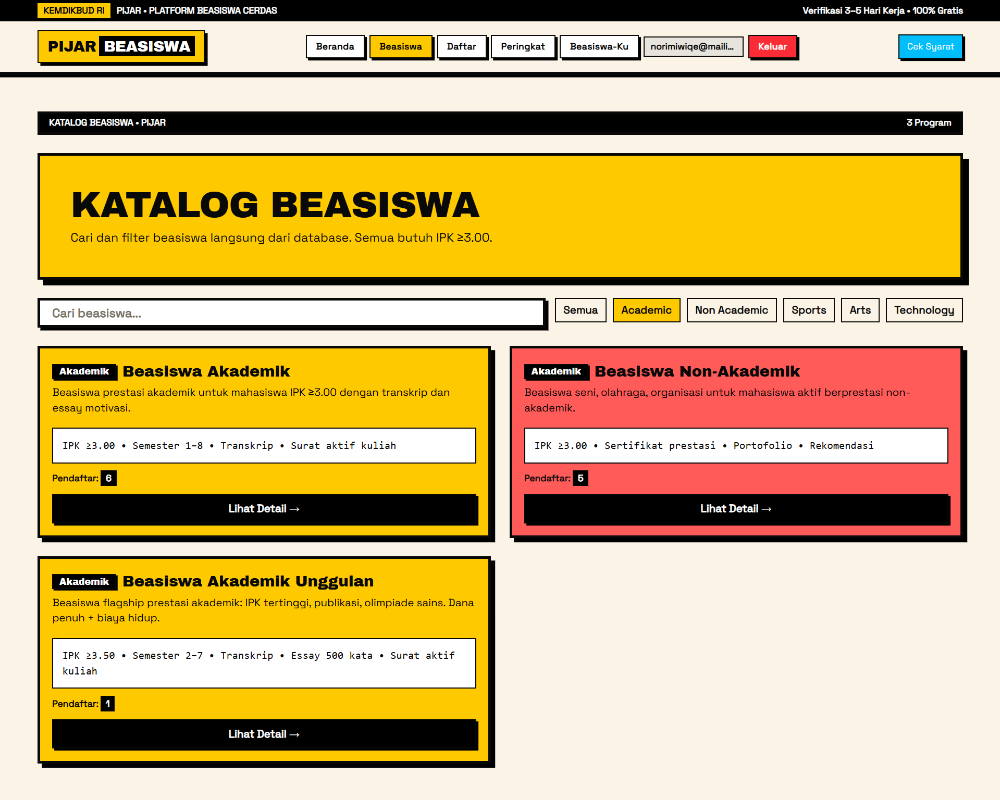

*Gambar 17 — Filter "Akademik" aktif.*

Saat filter dipilih, frontend mengirim parameter `type=academic` ke API. Hasilnya hanya beasiswa dengan jenis tersebut. Filter tidak menghapus data; ia hanya mempersempit tampilan.

**Pencarian**

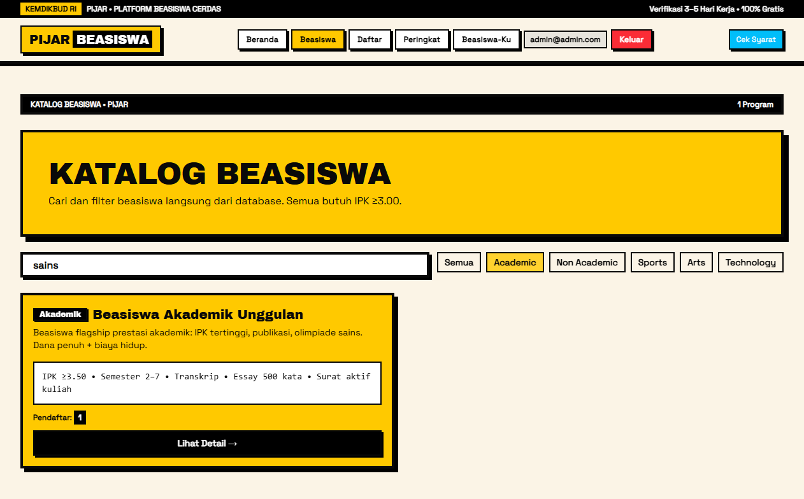

*Gambar 18 — Pencarian "sains" menampilkan Beasiswa Sains & Teknologi.*

Pencarian mencocokkan nama, deskripsi, dan slug. Jadi kata "sains" bisa menemukan beasiswa meskipun kata itu hanya muncul di deskripsi.

**Di balik layar**

```text
Pengguna mengetik
   ↓
state pencarian berubah
   ↓
React Query memanggil /scholarships?search=...&type=...
   ↓
Laravel menjalankan WHERE LIKE
   ↓
hasil dikembalikan dan kartu diperbarui
```

### 6.3 Detail Beasiswa


*Gambar 19 — Detail Beasiswa Akademik.*

**Isi halaman**

- Nama dan jenis beasiswa.
- Deskripsi lengkap.
- Daftar syarat yang dipecah dari karakter `•`.
- Warna tema sebagai identitas visual.
- Tombol menuju formulir dengan `scholarship_id` sudah terpilih.

**Kenapa memakai slug**

Alamat `/beasiswa/akademik` lebih mudah dibaca dan dibagikan daripada `/beasiswa/9`. Slug juga stabil meskipun ID database berubah.

**Catatan implementasi**

Halaman detail saat ini memuat daftar beasiswa (`GET /scholarships?per_page=50`) lalu mencari `slug` yang cocok di browser. Endpoint `GET /scholarships/{scholarship}` tetap tersedia di API dan bisa dipakai jika nanti halaman detail ingin mengambil satu data saja. Pendekatan sekarang dipilih karena daftar beasiswa juga sudah dibutuhkan untuk navigasi dan pencarian.

### 6.4 Masuk dan Daftar Akun


*Gambar 20 — Halaman masuk.*


*Gambar 21 — Halaman daftar akun.*

**Alur autentikasi**

1. Pengguna mengirim email dan kata sandi.
2. Laravel memeriksa kecocokan di tabel `users`.
3. Jika cocok, Sanctum membuat token.
4. Frontend menyimpan `user` dan `token` di Zustand dengan `persist`, sehingga tetap ada setelah halaman dimuat ulang.
5. Setiap permintaan API berikutnya menyertakan token lewat header `Authorization`.

**Keamanan**

- Kata sandi disimpan dalam bentuk hash (`bcrypt`), bukan teks biasa.
- Token bisa dicabut saat logout.
- Halaman terproteksi tidak hanya menyembunyikan tombol; route-nya benar-benar dialihkan.
- Validasi tetap dilakukan di server, jadi memanggil API langsung tanpa token akan ditolak `401`.

### 6.5 Formulir dan Gerbang IPK


*Gambar 22 — Formulir pendaftaran.*


*Gambar 23 — Formulir terkunci saat IPK 2.9.*

**Dua kondisi**

| Kondisi | Tampilan | Yang aktif |
|---|---|---|
| IPK ≥ 3.00 | Label hijau **ELIGIBLE ≥ 3.0** | Semua field, picker, upload, tombol Daftar |
| IPK < 3.00 | Label merah **TIDAK MEMENUHI < 3.0** + alert | Hanya data diri dan IPK; sisanya terkunci |

**Mengapa gerbang ini penting**

Beasiswa memiliki syarat akademik. Kalau sistem membiarkan semua orang mengirim, panitia harus menyaring ulang secara manual. Gerbang ini menghemat waktu dan memberi umpan balik langsung kepada mahasiswa.

**Catatan jujur tentang demo IPK**

Pada versi ini, IPK adalah konstanta demo yang bisa diganti lewat tombol 3.4 / 2.9. Di aplikasi nyata, IPK seharusnya diambil dari sistem akademik setelah mahasiswa login, lalu dikunci agar tidak bisa dimanipulasi. Server tetap memvalidasi rentang 0–4, tetapi aturan "≥ 3.00" saat ini terutama dijaga di sisi klien dan dijalankan ulang saat pengujian.

### 6.6 Dialog Pemilih Beasiswa


*Gambar 24 — Dialog pemilih beasiswa.*

**Kenapa memakai dialog, bukan dropdown biasa**

Dropdown biasa hanya menampilkan nama. Dialog bisa menampilkan:

- deskripsi;
- syarat;
- warna tema;
- pencarian langsung.

Dengan begitu, pengguna bisa membandingkan beasiswa tanpa meninggalkan formulir.

**Cara kerja**

- Dialog mengambil daftar `scholarships` yang sudah dimuat.
- Kotak pencarian memfilter di sisi klien.
- Saat kartu diklik, dua nilai diisi: `beasiswa` (slug) dan `scholarship_id` (angka).
- `scholarship_id` dipakai backend untuk relasi; `beasiswa` disimpan sebagai teks agar riwayat tetap terbaca.

### 6.7 Unggah Berkas


*Gambar 25 — Berkas PDF sudah terpasang.*

**Aturan**

- Format: PDF atau ZIP.
- Ukuran maksimal: 5MB.
- Jumlah: satu file.
- File disimpan di `storage/app/public/berkas`.

**Alur teknis**

1. File dipilih lewat input atau drag-and-drop.
2. Frontend memasukkannya ke `FormData`.
3. `POST /beasiswa` dikirim sebagai `multipart/form-data`.
4. Laravel memvalidasi MIME dan ukuran.
5. File disimpan dengan nama acak.
6. Path disimpan di kolom `berkas_path`.
7. Resource menambahkan `berkas_url` agar frontend bisa membuka file.

**Kenapa PDF/ZIP**

PDF menjaga format dokumen resmi. ZIP memudahkan pengguna mengirim beberapa scan sekaligus tanpa membuat unggahan terpisah.

### 6.8 Beasiswa-Ku


*Gambar 26 — Tiga pengajuan awal milik akun demo.*


*Gambar 27 — Setelah pengajuan baru: total menjadi empat.*

**Tiga kartu ringkasan**

| Kartu | Rumus |
|---|---|
| Total Pengajuan | Semua baris milik user |
| Menunggu Verifikasi | Baris dengan status `belum di verifikasi` |
| Terverifikasi | Baris dengan status `lulus verifikasi` |

**Tabel riwayat**

Kolomnya: nama beasiswa, tanggal daftar, semester, IPK, berkas, status. Status ditampilkan sebagai badge:

- **BELUM DI VERIFIKASI** — kuning;
- **LULUS VERIFIKASI** — hijau;
- **DITOLAK** — merah.

**Kenapa halaman ini penting**

Tanpa halaman ini, pengguna hanya tahu "sudah kirim" tetapi tidak tahu nasib pengajuannya. Riwayat membuat proses transparan dan mengurangi pertanyaan ke panitia.

### 6.9 Peringkat


*Gambar 28 — Podium dan tabel peringkat.*

**Isi halaman**

- Podium tiga IPK tertinggi.
- Tabel pendaftar.
- Pencarian nama.
- Paginasi lima baris.

**Pencarian peringkat**

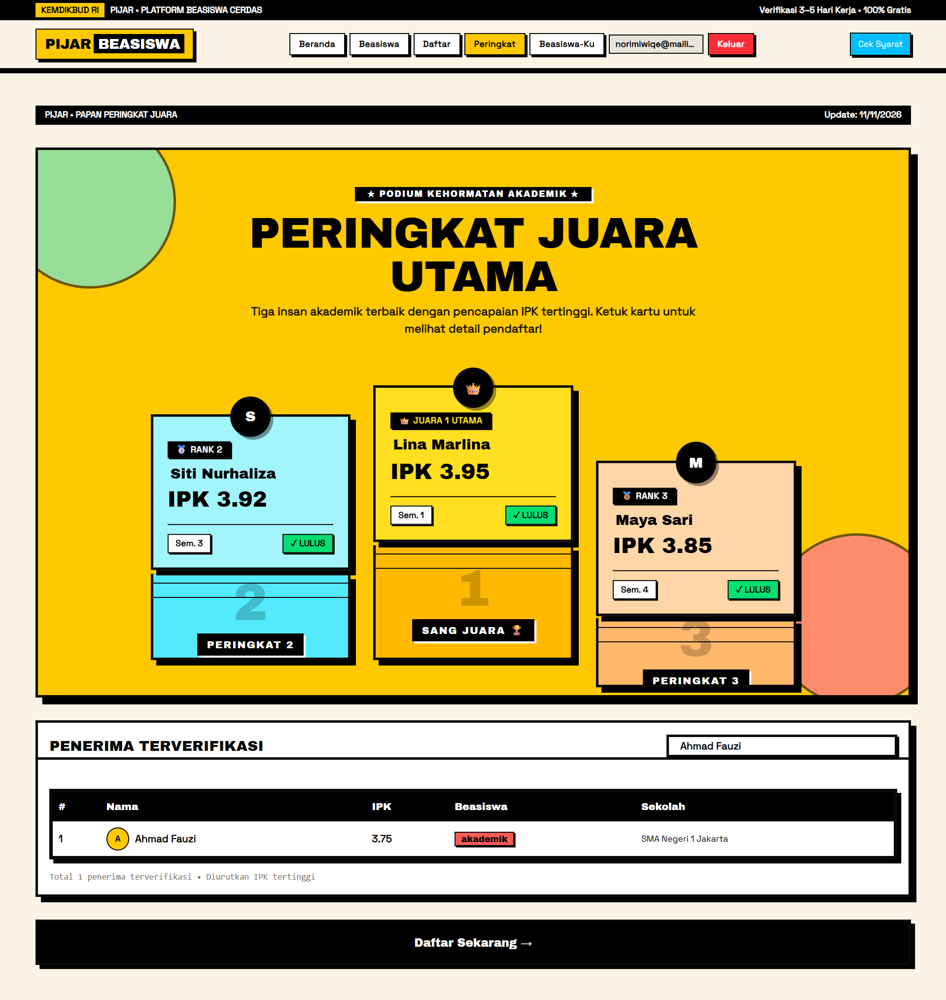

*Gambar 29 — Pencarian "Lina" pada halaman peringkat.*

Pencarian memakai parameter `search` ke endpoint `/beasiswa`. Backend mencocokkan nama, email, atau asal sekolah. Pencarian diberi jeda (debounce) 400ms agar tidak mengirim permintaan di setiap ketikan.

**Catatan privasi**

Halaman peringkat bersifat publik dan menampilkan nama serta asal sekolah. Di produksi, sebaiknya data pribadi disamarkan (misalnya nama disingkat) atau halaman dibatasi untuk pengguna login.

### 6.10 Kasus Tepi: Duplikat

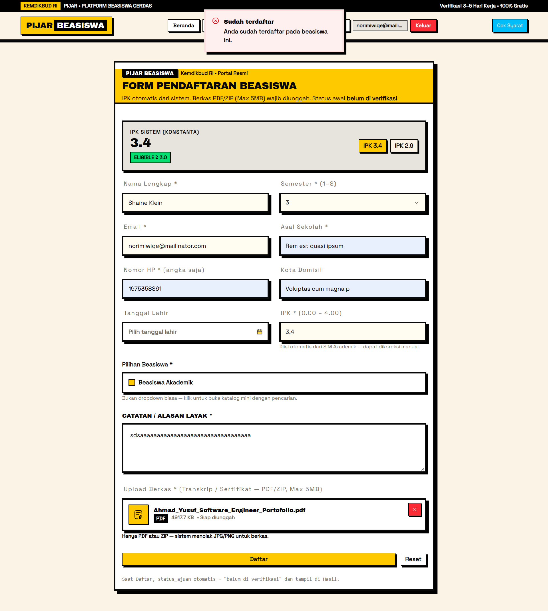

*Gambar 30 — Toast "Sudah terdaftar" saat mencoba mendaftar beasiswa yang sama.*

**Dua lapis pertahanan**

1. Frontend membandingkan `scholarship_id` dengan daftar pengajuan yang sudah dimuat. Jika cocok, muncul toast dan pengiriman dibatalkan.
2. Backend tetap memeriksa database. Jika frontend dilewati (misalnya lewat curl), server membalas `422`.

Lapisan kedua wajib ada karena frontend bisa dimanipulasi. Prinsipnya: **jangan pernah percaya sepenuhnya pada browser**.

### 6.11 Kasus Tepi: Validasi Formulir

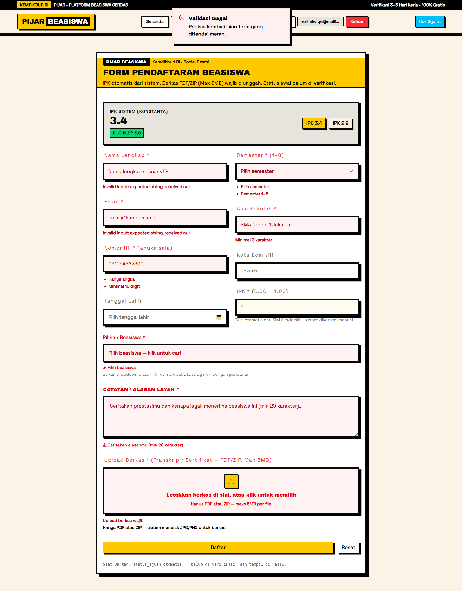

*Gambar 31 — Pesan validasi muncul di field yang salah.*

**Yang divalidasi**

- Nama minimal 3 karakter.
- Email harus berformat email.
- HP hanya angka, 10–15 digit.
- Semester wajib dipilih.
- IPK 0–4.
- Beasiswa wajib dipilih.
- Catatan minimal 20 karakter.
- Asal sekolah minimal 3 karakter.
- Berkas wajib, PDF/ZIP, maks 5MB.

**Perilaku yang nyaman**

- Pesan muncul di bawah field yang bermasalah.
- Field pertama yang salah otomatis difokuskan dan digulir ke tengah layar.
- Muncul toast **"Validasi Gagal"**.
- Suara error dimainkan (bisa diabaikan jika perangkat tidak mendukung).

### 6.12 Halaman 404


*Gambar 32 — Halaman 404.*

Alamat yang tidak dikenal tidak menampilkan layar putih atau error teknis. Pengguna tetap melihat navigasi dan bisa kembali.

### 6.13 Tampilan Mobile


*Gambar 33 — Tampilan ponsel.*

Diuji pada viewport 390×844. Hal yang diperiksa:

- tidak ada teks yang terpotong;
- tombol bisa disentuh;
- kartu tersusun satu kolom;
- navigasi tetap bisa dipakai;
- formulir tidak melebar keluar layar.

---

## 7. Potongan Kode Penting

Bagian ini menjelaskan kode yang paling menentukan perilaku aplikasi. Setiap potongan disertai penjelasan dalam bahasa sehari-hari.

### 7.1 Peta Route

**File:** `frontend/src/router/index.tsx`

```tsx
export const router = createBrowserRouter([
  {
    element: <AppLayout />,
    children: [
      { path: "/", element: <HomePage /> },
      { path: "/beasiswa", element: <BeasiswaCatalogPages /> },
      { path: "/beasiswa/:slug", element: <BeasiswaDetailPage /> },
      { path: "/login", element: <LoginPage /> },
      { path: "/register", element: <MasterRegisterBlock /> },
      {
        path: "/daftar",
        element: (
          <ProtectedRoute>
            <DaftarPage />
          </ProtectedRoute>
        ),
      },
      {
        path: "/beasiswa-ku",
        element: (
          <ProtectedRoute>
            <BeasiswaKuPage />
          </ProtectedRoute>
        ),
      },
      { path: "/peringkat", element: <PeringkatPage /> },
      { path: "*", element: <NotFound /> },
    ],
  },
]);
```

**Penjelasan**

- `createBrowserRouter` memakai URL asli browser, bukan hash.
- `AppLayout` membungkus semua halaman dengan navigasi dan footer.
- `:slug` adalah parameter dinamis. `/beasiswa/akademik` akan memberi `slug = "akademik"`.
- `ProtectedRoute` membungkus dua halaman yang memerlukan login.
- `path: "*"` menangkap semua alamat yang tidak cocok.

### 7.2 Penyimpanan Autentikasi

**File:** `frontend/src/store/auth.ts`

```ts
import { create } from "zustand"
import { persist } from "zustand/middleware"

type User = { id: number; name: string; email: string }

type AuthState = {
  user: User | null
  token: string | null
  setAuth: (user: User, token: string) => void
  setUser: (user: User | null) => void
  clear: () => void
}

export const useAuthStore = create<AuthState>()(
  persist(
    (set) => ({
      user: null,
      token: null,
      setAuth: (user, token) => set({ user, token }),
      setUser: (user) => set({ user }),
      clear: () => set({ user: null, token: null }),
    }),
    { name: "pijar:auth" }
  )
)
```

**Penjelasan**

- `persist` menyimpan state ke `localStorage` dengan kunci `pijar:auth`.
- Setelah halaman di-refresh, pengguna tidak perlu login ulang.
- `clear()` menghapus user dan token saat logout.
- Menyimpan token di `localStorage` mudah untuk demo, tetapi rawan XSS. Di produksi, pertimbangkan cookie `HttpOnly` atau strategi penyimpanan yang lebih aman.

### 7.3 Klien HTTP dan Token Otomatis

**File:** `frontend/src/api/ky.ts`

```ts
export const api = ky.create({
  prefix: base,
  timeout: 30000,
  retry: 0,
  credentials: "include",
  hooks: {
    beforeRequest: [
      ({ request }) => {
        request.headers.set("Accept", "application/json")
        try {
          const raw = localStorage.getItem("pijar:auth")
          if (raw) {
            const parsed = JSON.parse(raw) as { state?: { token?: string } }
            const token = parsed?.state?.token
            if (token) request.headers.set("Authorization", `Bearer ${token}`)
          }
        } catch {}
      },
    ],
  },
})
```

**Penjelasan**

- `prefix` membuat semua pemanggilan cukup menulis `"beasiswa"`, bukan URL lengkap.
- `timeout: 30000` memberi waktu 30 detik. Backend pengembangan berjalan satu proses, jadi permintaan paralel bisa mengantre.
- `retry: 0` mencegah pengiriman ganda saat server lambat.
- Hook `beforeRequest` membaca token dari `localStorage` dan menempelkannya ke header. Dengan begitu, setiap komponen tidak perlu mengurus token sendiri.
- `try/catch` kosong melindungi aplikasi dari JSON rusak di penyimpanan.

### 7.4 Skema Validasi Formulir

**File:** `frontend/src/components/ui/core/block/daftar/validations/daftar.schema.ts`

```ts
export const beasiswaFormSchema = z.object({
  nama: z.string().trim().min(3, "Minimal 3 karakter").max(100),
  email: z.string().trim().email("Format email tidak valid").max(255),
  hp: z
    .string()
    .regex(/^[0-9]+$/, "Hanya angka")
    .min(10, "Minimal 10 digit")
    .max(15),
  semester: z
    .string()
    .min(1, "Pilih semester")
    .refine(
      (v) => ["1", "2", "3", "4", "5", "6", "7", "8"].includes(v),
      "Semester 1–8",
    ),
  ipk: z.number().min(0).max(4),
  beasiswa: z.string().min(1, "Pilih beasiswa"),
  scholarship_id: z.number().min(1, "Pilih beasiswa"),
  catatan: z
    .string()
    .trim()
    .min(20, "Ceritakan alasanmu (min 20 karakter)")
    .max(2000),
  asal_sekolah: z.string().trim().min(3, "Minimal 3 karakter").max(100),
  tanggal_lahir: z.string().trim().max(30),
  kota_domisili: z.string().trim().max(100),
  berkas: z
    .array(z.union([z.instanceof(File), z.string()]))
    .min(1, "Upload berkas wajib")
    .max(1, "Maks 1 berkas"),
});
```

**Penjelasan**

- `trim()` membuang spasi di awal/akhir sebelum dihitung.
- `regex(/^[0-9]+$/)` memastikan nomor HP hanya angka.
- `refine` dipakai untuk aturan yang tidak bisa diwakili tipe dasar, seperti daftar semester yang diizinkan.
- `berkas` berupa array agar komponen unggah bisa menangani satu file dengan cara yang sama seperti banyak file.
- Tipe `BeasiswaFormValues` di bawahnya otomatis diturunkan dari skema, sehingga form dan validasi selalu sinkron.

### 7.5 Gerbang IPK

**File:** `frontend/src/components/ui/core/block/daftar/master-daftar-block.tsx`

```tsx
const liveIpk = useStore(form.store, (s) => s.values.ipk);
const isSubmitting = useStore(form.baseStore, (s) => s.isSubmitting);
const isModified = useStore(form.store, (s) => s.isDirty);
const effectiveIpk =
  typeof liveIpk === "number" && !Number.isNaN(liveIpk) ? liveIpk : ipk;
const isEligible = effectiveIpk >= 3;

useEffect(() => {
  form.setFieldValue("ipk", ipk);
}, [ipk, form]);
```

**Penjelasan**

- `liveIpk` membaca nilai IPK yang sedang diketik.
- Kalau nilainya belum berupa angka, sistem memakai nilai dari store.
- `isEligible` adalah satu-satunya sumber kebenaran untuk membuka atau mengunci form.
- `useEffect` menyelaraskan field form dengan store saat tombol demo 3.4/2.9 ditekan.
- `isSubmitting` dipakai untuk menonaktifkan tombol saat permintaan sedang berjalan, mencegah klik ganda.
- `isModified` menandai apakah pengguna sudah mengubah form.

### 7.6 Kirim Formulir dan Cek Duplikat

**File:** `frontend/src/components/ui/core/block/daftar/master-daftar-block.tsx`

```tsx
onSubmit: async ({ value }) => {
  const isDuplicate = myApps.some(
    (a) =>
      a.scholarship_id === value.scholarship_id && value.scholarship_id > 0,
  );

  const fd = new FormData();
  fd.append("nama", value.nama);
  fd.append("email", value.email);
  fd.append("hp", value.hp);
  fd.append("semester", value.semester);
  fd.append("ipk", String(value.ipk));
  fd.append("beasiswa", value.beasiswa);
  fd.append("scholarship_id", String(value.scholarship_id));
  fd.append("asal_sekolah", value.asal_sekolah);
  if (value.tanggal_lahir) fd.append("tanggal_lahir", value.tanggal_lahir);
  if (value.kota_domisili) fd.append("kota_domisili", value.kota_domisili);
  fd.append("catatan", value.catatan);

  const file = value.berkas[0];
  if (file instanceof File) {
    fd.append("berkas", file);
  }

  await submitApplication(fd, isEligible, isDuplicate);
},
```

**Penjelasan**

- `FormData` dipakai karena ada file. JSON tidak bisa membawa file biner dengan mudah.
- Semua nilai diubah ke string karena `FormData` hanya menerima string atau `Blob`.
- `scholarship_id` dikirim sebagai angka dalam bentuk string; Laravel akan mengubahnya kembali.
- `isDuplicate` dihitung sebelum pengiriman. Jika benar, `submitApplication` berhenti lebih awal.
- Hanya file pertama yang dikirim, sesuai aturan "maksimal satu berkas".

### 7.7 Fungsi Submit dan Redirect

**File:** `frontend/src/components/ui/core/block/daftar/hooks/use-daftar-mutations.ts`

```ts
const submitApplication = async (
  fd: FormData,
  isEligible: boolean,
  isDuplicate: boolean,
) => {
  await unlockSound();
  if (!isEligible) {
    playSound("blocked", { volume: 0.8 });
    toast.error("IPK di bawah 3.00", {
      description: "Tidak memenuhi syarat beasiswa.",
    });
    return false;
  }
  if (isDuplicate) {
    playSound("blocked");
    toast.error("Sudah terdaftar", {
      description: "Anda sudah terdaftar pada beasiswa ini.",
    });
    return false;
  }

  const processing = playSound("processing", { volume: 0.5 }) as unknown as {
    stop?: () => void;
  } | null;
  try {
    await createMutation.mutateAsync(fd);
    processing?.stop?.();
    playSound("success", { volume: 0.9 });
    toast.success("Pendaftaran berhasil", {
      description: 'Status: "belum di verifikasi" — cek di Beasiswa-Ku.',
    });
    navigate("/beasiswa-ku");
    return true;
  } catch (e) {
    processing?.stop?.();
    playSound("error");
    const msg = e instanceof Error ? e.message : "Gagal menyimpan";
    toast.error("Gagal", { description: msg });
    return false;
  }
};
```

**Penjelasan**

- Ada tiga gerbang sebelum data dikirim: kelayakan IPK, duplikat, lalu permintaan jaringan.
- `mutateAsync` mengembalikan Promise, sehingga `try/catch` bisa menangkap error HTTP.
- Setelah sukses, cache React Query dibersihkan oleh hook mutasi, lalu pengguna diarahkan ke `/beasiswa-ku`.
- Toast memberi tahu status awal secara eksplisit: **belum di verifikasi**.
- Suara bersifat opsional dan tidak memengaruhi keberhasilan data.

### 7.8 Cache React Query

**File:** `frontend/src/features/beasiswa/hooks.ts`

```ts
export function useCreateBeasiswa() {
  const qc = useQueryClient()
  return useMutation({
    mutationFn: (fd: FormData) => createBeasiswa(fd),
    retry: false,
    onSuccess: () => {
      qc.invalidateQueries({ queryKey: ["beasiswa"] })
      qc.invalidateQueries({ queryKey: ["my-beasiswa"] })
    },
  })
}
```

**Penjelasan**

- `retry: false` penting untuk operasi tulis. Kalau permintaan pertama sebenarnya berhasil tetapi jawabannya terlambat, mencoba ulang bisa membuat data ganda.
- `invalidateQueries` menandai data lama sebagai basi. React Query akan mengambil ulang saat halaman membutuhkannya.
- Dua cache dibersihkan: daftar publik (untuk peringkat) dan daftar milik pengguna (untuk Beasiswa-Ku).

### 7.9 Route API Laravel

**File:** `backend/routes/api.php`

```php
Route::prefix('v1')->group(function () {
    Route::get('/scholarships', [ScholarshipController::class, 'index'])->name('scholarships.index');
    Route::get('/scholarships/{scholarship}', [ScholarshipController::class, 'show'])->name('scholarships.show');

    Route::get('/beasiswa', [BeasiswaController::class, 'index'])->name('beasiswa.index');
    Route::get('/beasiswa/{beasiswa}', [BeasiswaController::class, 'show'])->name('beasiswa.show');
    Route::post('/beasiswa', [BeasiswaController::class, 'store'])->middleware('auth:sanctum')->name('beasiswa.store');

    Route::post('/register', [RegisteredUserController::class, 'store'])->name('api.register');
    Route::post('/login', [AuthenticatedSessionController::class, 'store'])->name('api.login');
    Route::post('/logout', [AuthenticatedSessionController::class, 'destroy'])->middleware('auth:sanctum')->name('api.logout');
    Route::get('/user', function (Request $request) {
        return response()->json(['data' => $request->user()]);
    })->middleware('auth:sanctum')->name('api.user');

    Route::get('/my-beasiswa', [BeasiswaController::class, 'myBeasiswa'])->middleware('auth:sanctum')->name('beasiswa.my');
});
```

**Penjelasan**

- `prefix('v1')` membuat semua alamat memiliki versi. Jika suatu hari ada perubahan besar, kita bisa menambah `/v2` tanpa merusak klien lama.
- Hanya `POST /beasiswa`, `GET /my-beasiswa`, `POST /logout`, dan `GET /user` yang memakai `auth:sanctum`.
- Route baca bersifat publik agar pengunjung bisa melihat katalog dan peringkat.
- Nama route memudahkan pembuatan URL di sisi server.

### 7.10 Controller: Validasi, Duplikat, dan Status

**File:** `backend/app/Http/Controllers/BeasiswaController.php`

```php
public function store(BeasiswaRequest $request): JsonResponse
{
    $validated = $request->validated();

    $user = $request->user();
    if (! $user) {
        return response()->json(['message' => 'Unauthenticated. Silakan login.'], 401);
    }

    $scholarshipId = $validated['scholarship_id'] ?? null;
    if (! $scholarshipId && ! empty($validated['beasiswa'])) {
        $scholarship = Scholarship::where('slug', $validated['beasiswa'])
            ->orWhere('name', $validated['beasiswa'])
            ->first();
        $scholarshipId = $scholarship?->id;
    }
    if (! $scholarshipId) {
        return response()->json([
            'message' => 'scholarship_id wajib diisi.',
            'errors' => ['scholarship_id' => ['Pilih beasiswa.']],
        ], 422);
    }

    $exists = Beasiswa::where('user_id', $user->id)
        ->where('scholarship_id', $scholarshipId)
        ->exists();
    if ($exists) {
        return response()->json([
            'message' => 'Anda sudah terdaftar pada beasiswa ini.',
        ], 422);
    }

    $berkasPath = null;
    if ($request->hasFile('berkas')) {
        $berkasPath = $request->file('berkas')->store('berkas', 'public');
    }

    $beasiswa = Beasiswa::create([
        'nama' => $validated['nama'],
        'email' => $validated['email'],
        'hp' => $validated['hp'],
        'semester' => $validated['semester'],
        'ipk' => $validated['ipk'],
        'beasiswa' => $validated['beasiswa'] ?? null,
        'scholarship_id' => $scholarshipId,
        'user_id' => $user?->id,
        'asal_sekolah' => $validated['asal_sekolah'] ?? null,
        'nomor_telepon' => $validated['nomor_telepon'] ?? $validated['hp'] ?? null,
        'tanggal_lahir' => $validated['tanggal_lahir'] ?? null,
        'kota_domisili' => $validated['kota_domisili'] ?? null,
        'catatan' => $validated['catatan'] ?? null,
        'berkas_path' => $berkasPath,
        'status_ajuan' => 'belum di verifikasi',
    ]);

    return response()->json([
        'data' => new BeasiswaResource($beasiswa),
        'message' => 'Pendaftaran beasiswa berhasil',
    ], 201);
}
```

**Penjelasan**

- `BeasiswaRequest` sudah memvalidasi input sebelum method ini berjalan. Jika gagal, Laravel otomatis membalas `422`.
- `$request->user()` berasal dari token Sanctum. Kalau tidak ada, permintaan ditolak.
- `scholarship_id` bisa dikirim langsung atau dicari dari slug/nama. Ini membuat API ramah terhadap klien lama.
- Pemeriksaan duplikat dilakukan **sebelum** file disimpan, agar tidak ada file yatim saat pengajuan ditolak.
- `store('berkas', 'public')` menyimpan file di disk `public` dengan nama acak.
- `status_ajuan` diisi di server, bukan dari input pengguna. Ini mencegah pendaftar memberi status "lulus" sendiri.
- Balasan `201` menandakan data baru berhasil dibuat.

### 7.11 Validasi Server

**File:** `backend/app/Http/Requests/BeasiswaRequest.php`

```php
public function rules(): array
{
    return [
        'nama' => ['required', 'string', 'min:3', 'max:100'],
        'email' => ['required', 'email', 'max:255'],
        'hp' => ['required', 'regex:/^[0-9]+$/', 'min:10', 'max:15'],
        'semester' => ['required', 'integer', 'between:1,8'],
        'ipk' => ['required', 'numeric', 'between:0,4'],
        'beasiswa' => ['nullable', 'string', 'max:100'],
        'scholarship_id' => ['nullable', 'exists:scholarships,id'],
        'asal_sekolah' => ['required', 'string', 'min:3', 'max:100'],
        'nomor_telepon' => ['nullable', 'regex:/^[0-9+]+$/', 'min:10', 'max:16'],
        'tanggal_lahir' => ['nullable', 'date', 'before:today'],
        'kota_domisili' => ['nullable', 'string', 'min:3', 'max:100'],
        'catatan' => ['required', 'string', 'min:20', 'max:2000'],
        'berkas' => ['nullable', 'file', 'mimes:pdf,zip', 'max:5120'],
    ];
}
```

**Penjelasan**

- `exists:scholarships,id` memastikan ID yang dikirim benar-benar ada. Tanpa aturan ini, pengajuan bisa menunjuk ke beasiswa hantu.
- `mimes:pdf,zip` memeriksa isi file, bukan hanya ekstensi.
- `max:5120` berarti 5120 KB = 5MB.
- `before:today` mencegah tanggal lahir di masa depan.
- Aturan ini adalah pertahanan terakhir. Validasi browser bisa dilewati; validasi server tidak.

### 7.12 Resource: Bentuk Jawaban API

**File:** `backend/app/Http/Resources/BeasiswaResource.php`

```php
public function toArray(Request $request): array
{
    return [
        'id' => $this->id,
        'nama' => $this->nama,
        'email' => $this->email,
        'hp' => $this->hp,
        'semester' => $this->semester,
        'ipk' => $this->ipk,
        'beasiswa' => $this->beasiswa,
        'scholarship_id' => $this->scholarship_id,
        'scholarship' => $this->whenLoaded('scholarship'),
        'asal_sekolah' => $this->asal_sekolah,
        'nomor_telepon' => $this->nomor_telepon,
        'tanggal_lahir' => $this->tanggal_lahir,
        'kota_domisili' => $this->kota_domisili,
        'catatan' => $this->catatan,
        'berkas_path' => $this->berkas_path,
        'berkas_url' => $this->berkas_path ? asset('storage/'.$this->berkas_path) : null,
        'status_ajuan' => $this->status_ajuan,
        'user_id' => $this->user_id,
        'created_at' => $this->created_at?->toISOString(),
        'updated_at' => $this->updated_at?->toISOString(),
    ];
}
```

**Penjelasan**

- Resource memisahkan bentuk database dari bentuk API. Kita bisa mengubah nama field tanpa mengubah skema.
- `whenLoaded('scholarship')` hanya menyertakan relasi jika sudah di-*eager load*. Ini mencegah query tambahan yang tidak perlu.
- `berkas_url` dihitung dari path, sehingga frontend tidak perlu tahu struktur folder storage.
- Tanggal dikirim dalam format ISO agar mudah diolah JavaScript.

### 7.13 Unique Index Anti-Duplikat

**File:** `backend/database/migrations/2026_09_09_000001_per_scholarship_unique_on_beasiswas.php`

```php
Schema::table('beasiswas', function (Blueprint $table) {
    try {
        $table->dropUnique(['user_id']);
    } catch (\Throwable) {
        // SQLite atau sudah dihapus — lanjutkan.
    }
});

Schema::table('beasiswas', function (Blueprint $table) {
    $table->unique(['user_id', 'scholarship_id'], 'beasiswas_user_scholarship_unique');
});
```

**Penjelasan**

- Versi awal hanya membatasi satu pengajuan per user. Aturan itu terlalu ketat: mahasiswa boleh mendaftar beberapa beasiswa berbeda.
- Migrasi ini menghapus unique lama, lalu membuat unique gabungan.
- `try/catch` membuat migrasi aman di SQLite yang kadang tidak mendukung `dropUnique`.
- Unique index adalah jaring pengaman terakhir. Bahkan jika dua permintaan lolos pemeriksaan aplikasi, database menolak baris kedua.

### 7.14 Relasi Model

**File:** `backend/app/Models/Beasiswa.php`

```php
public function user()
{
    return $this->belongsTo(User::class);
}

public function scholarship()
{
    return $this->belongsTo(Scholarship::class);
}
```

**File:** `backend/app/Models/Scholarship.php`

```php
public function beasiswas()
{
    return $this->hasMany(Beasiswa::class);
}
```

**Penjelasan**

- `belongsTo` dipakai di sisi "banyak" (pengajuan menunjuk ke satu beasiswa).
- `hasMany` dipakai di sisi "satu" (satu beasiswa punya banyak pengajuan).
- Dengan relasi ini, controller bisa memakai `with('scholarship')` untuk mengambil data beasiswa sekaligus, menghindari masalah N+1 query.

### 7.15 Filter dan Paginasi di Controller

**File:** `backend/app/Http/Controllers/ScholarshipController.php`

```php
$query = Scholarship::query()->withCount('beasiswas');

if ($search = $request->query('search')) {
    $query->where(function ($q) use ($search) {
        $q->where('name', 'like', "%{$search}%")
            ->orWhere('description', 'like', "%{$search}%")
            ->orWhere('slug', 'like', "%{$search}%");
    });
}

if ($type = $request->query('type')) {
    $query->where('type', $type);
}

$query->orderByDesc('beasiswas_count')->orderBy('name');

$perPage = max(1, min(50, (int) $request->query('per_page', 50)));
$paginated = $query->paginate($perPage);
```

**Penjelasan**

- `withCount('beasiswas')` menambahkan kolom `beasiswas_count` tanpa memuat semua baris relasi.
- Pencarian dibungkus dalam closure agar `OR` tidak mengacaukan filter `type`.
- `orderByDesc('beasiswas_count')` menampilkan beasiswa populer lebih dulu.
- `max(1, min(50, ...))` membatasi `per_page` agar seseorang tidak meminta 1.000.000 baris sekaligus.

---

## 8. Struktur Database

### 8.1 Tabel `users`

| Kolom | Tipe | Keterangan |
|---|---|---|
| `id` | bigint | Primary key |
| `name` | string | Nama pengguna |
| `email` | string | Unik, dipakai login |
| `password` | string | Hash bcrypt |
| `created_at`, `updated_at` | timestamp | Waktu dibuat/diubah |

### 8.2 Tabel `scholarships`

| Kolom | Tipe | Keterangan |
|---|---|---|
| `id` | bigint | Primary key |
| `name` | string | Nama beasiswa |
| `slug` | string | Alamat URL, unik |
| `type` | string | `academic`, `non_academic`, `sports`, `arts`, `technology` |
| `description` | text | Deskripsi |
| `color_theme` | string | Warna OKLCH |
| `requirements` | text | Syarat, dipisah `•` |
| `created_at`, `updated_at` | timestamp | Waktu dibuat/diubah |

### 8.3 Tabel `beasiswas`

| Kolom | Tipe | Keterangan |
|---|---|---|
| `id` | bigint | Primary key |
| `nama` | string(100) | Nama pendaftar |
| `email` | string(255) | Email pendaftar |
| `hp` | string(15) | Nomor HP |
| `semester` | tinyint | 1–8 |
| `ipk` | decimal(3,2) | 0.00–4.00 |
| `beasiswa` | string | Slug/nama beasiswa (teks) |
| `scholarship_id` | bigint FK | Relasi ke `scholarships` |
| `user_id` | bigint FK | Relasi ke `users` |
| `asal_sekolah` | string | Sekolah asal |
| `nomor_telepon` | string | Nomor telepon tambahan |
| `tanggal_lahir` | date | Tanggal lahir |
| `kota_domisili` | string | Kota domisili |
| `catatan` | text | Alasan mendaftar |
| `berkas_path` | string | Lokasi file di storage |
| `status_ajuan` | string | Default `belum di verifikasi` |
| `created_at`, `updated_at` | timestamp | Waktu dibuat/diubah |

**Index penting**

- `beasiswas_user_scholarship_unique` pada `(user_id, scholarship_id)`.
- Foreign key `user_id` memakai `cascadeOnDelete`: jika user dihapus, pengajuannya ikut terhapus.
- Foreign key `scholarship_id` memakai `nullOnDelete`: jika beasiswa dihapus, riwayat pengajuan tetap ada tetapi relasinya menjadi kosong.

### 8.4 Data Awal (Seeder)

`ScholarshipSeeder` mengisi **10 beasiswa**:

1. Beasiswa Akademik Unggulan
2. Beasiswa Seni & Budaya Nusantara
3. Beasiswa Atlet Berprestasi
4. Beasiswa Sains & Teknologi
5. Beasiswa Aktivis Muda
6. Beasiswa Hafiz Quran
7. Beasiswa Inovasi Digital
8. Beasiswa Disabilitas Inspiratif
9. Beasiswa Akademik
10. Beasiswa Non-Akademik

`BeasiswaSeeder` mengisi **10 pengajuan contoh** dengan status campuran: `lulus verifikasi`, `belum di verifikasi`, dan `ditolak`. `DatabaseSeeder` juga membuat akun `admin@admin.com`.

Saat dokumentasi ini dibuat, database berisi **14 pengajuan** karena akun admin memiliki 4 pengajuan (3 dari seeder/percobaan sebelumnya + 1 pengajuan demo melalui UI).

---

## 9. Cara Menjalankan Proyek

### 9.1 Prasyarat

- PHP 8.3 atau lebih baru
- Composer 2.7+
- Node.js 20+ (disarankan 22 LTS)
- npm 10+
- Git

Cek versi:

```bash
php -v
composer -V
node -v
npm -v
```

### 9.2 Menjalankan Backend

```bash
cd backend
composer install
cp .env.example .env
php artisan key:generate
php artisan migrate --seed
php artisan storage:link
php artisan serve --host=127.0.0.1 --port=8000
```

Di Windows, `cp` bisa diganti:

```powershell
Copy-Item .env.example .env
```

Kalau file SQLite belum ada:

```powershell
New-Item -ItemType File -Force database\database.sqlite
```

Backend siap di <http://127.0.0.1:8000/api/v1>.

### 9.3 Menjalankan Frontend

```bash
cd frontend
npm install
cp .env.example .env
npm run dev
```

Isi `.env`:

```ini
VITE_API_URL=http://127.0.0.1:8000/api/v1
```

Frontend siap di <http://localhost:5173>.

### 9.4 Akun Demo

| Email | Kata sandi |
|---|---|
| `admin@admin.com` | `password` |

### 9.5 Perintah Pemeriksaan

```bash
# Backend
cd backend
php artisan test --compact
vendor/bin/pint --dirty --format agent

# Frontend
cd frontend
npx tsc --noEmit
npm run build
npm run lint
```

### 9.6 Checklist Pengujian Manual

| No | Skenario | Hasil yang diharapkan | Status |
|---|---|---|---|
| 1 | Buka beranda | Hero, navigasi, statistik tampil | Lulus |
| 2 | Buka katalog | 10 beasiswa tampil | Lulus |
| 3 | Filter akademik | Hanya beasiswa akademik | Lulus |
| 4 | Cari "sains" | Beasiswa Sains & Teknologi muncul | Lulus |
| 5 | Buka detail | Syarat dan CTA tampil | Lulus |
| 6 | Buka `/daftar` tanpa login | Dialihkan ke `/login` | Lulus |
| 7 | Login akun demo | Nama dan tombol Keluar muncul | Lulus |
| 8 | Buka formulir | Field terisi nama/email | Lulus |
| 9 | Set IPK 2.9 | Picker, upload, submit terkunci | Lulus |
| 10 | Set IPK 3.4 | Semua kontrol terbuka | Lulus |
| 11 | Pilih beasiswa | Dialog mencari dan memilih | Lulus |
| 12 | Upload PDF | Nama file tampil | Lulus |
| 13 | Submit valid | Toast sukses + redirect | Lulus |
| 14 | Cek Beasiswa-Ku | Pengajuan baru muncul | Lulus |
| 15 | Submit beasiswa sama | Toast "Sudah terdaftar" | Lulus |
| 16 | Submit form kosong | Pesan validasi per field | Lulus |
| 17 | Cari "Lina" di peringkat | Hanya baris yang cocok | Lulus |
| 18 | Buka alamat acak | Halaman 404 | Lulus |
| 19 | Perkecil ke 390px | Layout tetap rapi | Lulus |

---

## 10. Troubleshooting

### 10.1 Frontend Menampilkan "Gagal terhubung ke server"

**Penyebab:** backend belum berjalan atau `VITE_API_URL` salah.

**Solusi:**

1. Pastikan `php artisan serve` berjalan di port 8000.
2. Buka <http://127.0.0.1:8000/api/v1/scholarships> di browser. Harus muncul JSON.
3. Periksa `frontend/.env`, pastikan `VITE_API_URL=http://127.0.0.1:8000/api/v1`.
4. Hentikan lalu jalankan ulang `npm run dev` karena Vite membaca env saat start.

### 10.2 Muncul 401 Saat Membuka Beasiswa-Ku

**Penyebab:** token tidak ada, kedaluwarsa, atau terhapus.

**Solusi:**

1. Logout, lalu login ulang.
2. Buka DevTools → Application → Local Storage → `pijar:auth`. Pastikan ada `token`.
3. Kalau token ada tetapi tetap 401, hapus `pijar:auth`, refresh, lalu login lagi.

### 10.3 Tombol Daftar Tidak Bisa Ditekan

**Penyebab:** IPK di bawah 3.00.

**Solusi:** tekan tombol **IPK 3.4** di panel IPK. Kalau tetap terkunci, periksa apakah field IPK berisi angka valid (0–4).

### 10.4 Muncul "Sudah terdaftar"

**Penyebab:** akun tersebut sudah pernah mendaftar beasiswa yang sama.

**Solusi:** pilih beasiswa lain. Aturan satu pengajuan per beasiswa memang disengaja. Kalau data lama perlu dihapus, lakukan lewat database dengan hati-hati.

### 10.5 Berkas Tidak Bisa Dibuka

**Penyebab:** symlink storage belum dibuat.

**Solusi:**

```bash
cd backend
php artisan storage:link
```

Pastikan juga file benar-benar ada di `backend/storage/app/public/berkas`.

### 10.6 Halaman 404 Saat Refresh di Server Produksi

**Penyebab:** server web tidak diarahkan ke `index.html` untuk semua route SPA.

**Solusi:** konfigurasi fallback:

- **Nginx:** `try_files $uri $uri/ /index.html;`
- **Apache:** aktifkan `mod_rewrite` dan arahkan semua request ke `index.html`.
- **Vercel/Netlify:** tambahkan aturan rewrite `/*` ke `/index.html`.

### 10.7 CORS Error

**Penyebab:** alamat frontend tidak diizinkan backend.

**Solusi:** periksa `backend/config/cors.php`, pastikan `http://localhost:5173` ada di `allowed_origins`. Setelah mengubah konfigurasi, jalankan:

```bash
php artisan config:clear
```

### 10.8 Upload Ditolak

| Pesan | Penyebab | Solusi |
|---|---|---|
| "Berkas hanya boleh pdf atau zip" | Format salah | Konversi ke PDF atau ZIP |
| "Ukuran berkas maksimal 5MB" | File terlalu besar | Kompres atau pecah file |
| "Upload berkas wajib" | Belum memilih file | Pilih file terlebih dahulu |

### 10.9 Perubahan Kode Tidak Muncul

**Solusi:**

1. Pastikan `npm run dev` masih berjalan.
2. Hentikan dan jalankan ulang bila perlu.
3. Untuk build produksi, jalankan `npm run build`.
4. Kosongkan cache browser dengan `Ctrl + Shift + R`.

---

## 11. Ringkasan & Batasan

### 11.1 Yang Sudah Berfungsi

- Beranda dengan navigasi dan statistik.
- Katalog dengan pencarian, filter, dan paginasi.
- Detail beasiswa berbasis slug.
- Registrasi dan login dengan token Sanctum.
- Proteksi route `/daftar` dan `/beasiswa-ku`.
- Gerbang IPK 3.00 yang mengunci form.
- Dialog pemilih beasiswa dengan pencarian.
- Unggah PDF/ZIP maksimal 5MB.
- Validasi ganda: Zod di browser dan Form Request di server.
- Anti-duplikat di frontend, backend, dan database.
- Status awal `belum di verifikasi` diisi server.
- Halaman Beasiswa-Ku dengan ringkasan dan riwayat.
- Halaman peringkat dengan pencarian dan paginasi.
- Halaman 404 dan tampilan mobile.
- 19 screenshot asli sebagai bukti pengujian.

### 11.2 Batasan yang Perlu Diketahui

1. **Belum ada halaman admin.** Status verifikasi belum bisa diubah lewat UI. Perubahan masih lewat database/API.
2. **IPK masih konstanta demo.** Tombol 3.4/2.9 dipakai untuk memperagakan gerbang. Di produksi, IPK harus berasal dari sistem akademik dan tidak bisa diubah pengguna.
3. **Token disimpan di `localStorage`.** Mudah untuk demo, tetapi kurang ideal untuk produksi. Pertimbangkan cookie `HttpOnly`.
4. **Peringkat menampilkan data pribadi.** Nama dan asal sekolah terlihat publik. Di produksi, pertimbangkan penyamaran data.
5. **Belum ada email notifikasi.** Perubahan status tidak mengirim email otomatis.
6. **Belum ada pembatalan pengajuan.** Pengguna belum bisa menarik pengajuan sendiri.
7. **Satu berkas per pengajuan.** Jika panitia membutuhkan banyak dokumen, gunakan ZIP atau tambah field baru.
8. **SQLite untuk lokal.** Untuk banyak pengguna bersamaan, gunakan PostgreSQL/Neon seperti yang sudah disiapkan di konfigurasi.

### 11.3 Saran Pengembangan Berikutnya

- Halaman admin untuk verifikasi dan alasan penolakan.
- Integrasi IPK dari sistem akademik.
- Notifikasi email/WhatsApp saat status berubah.
- Riwayat perubahan status (audit trail).
- Pembatalan atau perbaikan pengajuan.
- Penyamaran data pada halaman publik.
- Unggah beberapa berkas dengan jenis dokumen yang jelas.
- Pembatasan ukuran dan pemindaian malware untuk file unggahan.

---

## 12. Lampiran: Indeks Screenshot

Semua gambar berada di `assets/images/mockup/` dan diambil langsung dari aplikasi yang berjalan.

| No | File | Halaman/Situasi |
|---|---|---|
| 1 | `01-beranda.png` | Beranda desktop |
| 2 | `02-katalog-beasiswa.png` | Katalog beasiswa |
| 3 | `03-detail-beasiswa.png` | Detail Beasiswa Akademik |
| 4 | `04-peringkat.png` | Halaman peringkat |
| 5 | `05-masuk.png` | Halaman login |
| 6 | `06-daftar-akun.png` | Halaman registrasi |
| 7 | `07-404.png` | Halaman 404 |
| 8 | `08-form-pendaftaran.png` | Formulir pendaftaran kosong |
| 9 | `09-form-ipk-tidak-memenuhi.png` | Formulir saat IPK 2.9 |
| 10 | `10-dialog-pilih-beasiswa.png` | Dialog pemilih beasiswa |
| 11 | `11-beasiswa-ku.png` | Beasiswa-Ku sebelum pengajuan baru |
| 12 | `12-form-terisi.png` | Formulir terisi lengkap |
| 13 | `13-beasiswa-ku-setelah-daftar.png` | Beasiswa-Ku setelah pengajuan baru |
| 14 | `14-katalog-filter-akademik.png` | Filter akademik |
| 15 | `15-katalog-pencarian.png` | Pencarian "sains" |
| 16 | `16-peringkat-pencarian.png` | Pencarian "Lina" di peringkat |
| 17 | `17-beranda-mobile.png` | Beranda pada 390×844 |
| 18 | `18-duplikat-terdeteksi.png` | Toast duplikat |
| 19 | `19-validasi-form.png` | Error validasi formulir |

---

**Dokumen ini dibuat berdasarkan pengujian langsung pada 11 November 2026.**
**Frontend:** <http://localhost:5173> · **API:** <http://127.0.0.1:8000/api/v1>
